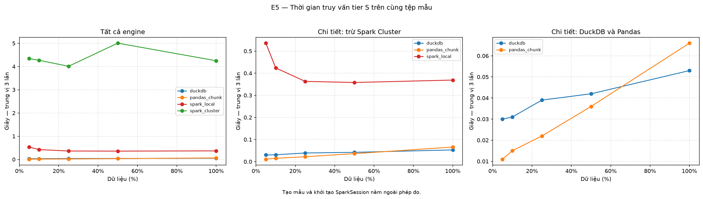
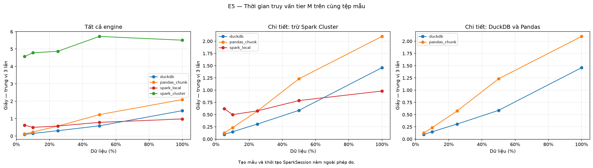
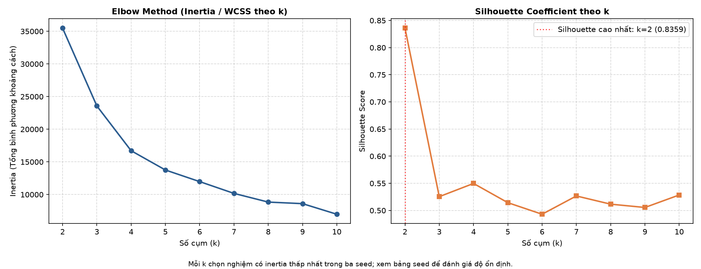
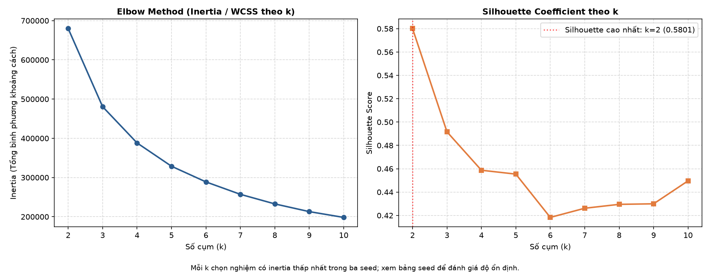

# BẢN THẢO NỘI DUNG BÁO CÁO — THÀNH VIÊN 5 (M5)
**Môn học:** Nhập môn Dữ liệu lớn (841450) — Trường Đại học Sài Gòn  
**Dự án:** BasketLake — E-commerce Behavior Intelligence Platform  
**Phụ trách:** Thành viên 5 (M5)  
**Phạm vi:** Chương 2 (Cơ sở lý thuyết), Chương 6 mục 6.5 E5 và 6.6 E6; mục 6.7 bổ sung kết quả RFM/KMeans tier S và M.

---

# CHƯƠNG 2: CƠ SỞ LÝ THUYẾT

## 2.1. Tổng quan Kiến trúc Apache Spark

### 2.1.1. Mô hình Tính toán Phân tán và Kiến trúc Master-Worker
Apache Spark là nền tảng điện toán phân tán mã nguồn mở được thiết kế để xử lý dữ liệu quy mô lớn (Big Data) với hiệu năng cao dựa trên cơ chế tính toán trong bộ nhớ (in-memory computing). Kiến trúc của Spark tuân theo mô hình **Master-Worker**:

1. **Driver Program:** Nơi khởi tạo ứng dụng (`SparkSession`), chuyển đổi mã lệnh cấp cao của người dùng thành đồ thị có hướng không chu trình (**DAG — Directed Acyclic Graph**), lên lịch trình (Task Scheduler) và phân phối các đơn vị công việc (Tasks) đến các cụm máy tính.
2. **Cluster Manager (Spark Master / Standalone):** Chịu trách nhiệm quản lý tài nguyên tính toán (CPU Cores, RAM) trên toàn bộ hệ thống phân tán, phân bổ tài nguyên cho ứng dụng khi Driver yêu cầu.
3. **Executors (Workers):** Các tiến trình chạy trên các node công nhân (Worker Nodes). Mỗi Executor chịu trách nhiệm chạy các Task được giao, duy trì vùng đệm dữ liệu trong bộ nhớ (`BlockManager`) và trả kết quả về cho Driver.

### 2.1.2. Trừu tượng hóa Dữ liệu: RDD, DataFrame và Bộ tối ưu Catalyst
- **RDD (Resilient Distributed Dataset):** Trừu tượng hóa cốt lõi của Spark, là tập hợp dữ liệu phân tán, bất biến (immutable), có khả năng phục hồi lỗi thông qua phả hệ đồ thị (*Lineage Graph*).
- **DataFrame & Dataset:** Cung cấp API có cấu trúc với schema rõ ràng, cho phép xử lý dữ liệu dạng bảng tương tự quan hệ SQL.
- **Catalyst Optimizer:** Thành phần phân tích và tối ưu kế hoạch truy vấn Spark SQL, gồm các bước giải quyết schema và tối ưu như predicate pushdown, projection pruning. Kế hoạch vật lý có thể dùng whole-stage code generation khi toán tử hỗ trợ.

### 2.1.3. Cơ chế Thực thi Lười (Lazy Evaluation) và Biến đổi Narrow vs. Wide
Trong Spark, các thao tác được chia thành 2 loại:
1. **Transformations (Biến đổi lười - Lazy):** Các hàm không tính toán ngay lập tức mà chỉ ghi nhận vào đồ thị DAG kế hoạch biến đổi:
   - *Narrow Transformation:* Các phép toán mà mỗi phân vùng (partition) đầu ra chỉ phụ thuộc vào đúng một phân vùng đầu vào (ví dụ: `filter()`, `select()`, `map()`). Không đòi hỏi trao đổi dữ liệu qua mạng giữa các executor.
   - *Wide Transformation:* Các phép toán cần dữ liệu từ nhiều phân vùng để tạo đầu ra (ví dụ: tổng hợp theo khóa). Chúng thường tạo ranh giới **Stage** và **Shuffle**; Spark có thể chọn broadcast join để tránh shuffle ở một phía của phép nối.
2. **Actions (Hành động kích hoạt):** Các câu lệnh yêu cầu trả kết quả về Driver hoặc ghi dữ liệu ra bộ nhớ ngoài (ví dụ: `count()`, `collect()`, `write.parquet()`). Khi gặp Action, toàn bộ chuỗi DAG mới chính thức được Spark biên dịch và thực thi.

### 2.1.4. Cơ chế Xáo trộn Dữ liệu (Shuffle Mechanism)
**Shuffle** là quá trình phân phối lại dữ liệu giữa các phân vùng, thường theo khóa, để phục vụ tổng hợp hoặc kết nối. Nó có thể tốn nhiều tài nguyên vì:
- **Disk I/O:** Dữ liệu trung gian của các mapper tasks phải được ghi tạm thời xuống đĩa cục bộ.
- **Network I/O:** Dữ liệu được truyền tải qua hạ tầng mạng giữa các node Worker vật lý.
- **Serialization / Deserialization:** Dữ liệu phải được đóng gói và giải nén giữa bộ nhớ Java và đường truyền mạng.

---

## 2.2. Phân Tích Khách Hàng Bằng Mô Hình RFM

### 2.2.1. Ba Chiều Đo Cốt Lõi
Mô hình RFM là phương pháp kinh điển trong khoa học dữ liệu thương mại điện tử nhằm định lượng giá trị và hành vi của người tiêu dùng:
- **Recency ($R$):** Số ngày từ `last_purchase_ts` gần nhất của khách hàng đến mốc phân tích (`as_of_date = '2019-11-30'`). Giá trị $R$ nhỏ hơn nghĩa là lần mua gần mốc phân tích hơn.
- **Frequency ($F$):** Số phiên có ít nhất một sự kiện `purchase` của khách hàng. Dữ liệu không có mã đơn hàng để đếm số đơn riêng biệt.
- **Monetary ($M$):** Tổng `price` của các sự kiện purchase trong khoảng quan sát; đây là doanh thu đại diện vì dữ liệu không có số lượng hoặc mã đơn hàng.

### 2.2.2. Tiền Xử Lý Dữ Liệu cho Học Không Giám Sát (KMeans)
Với dữ liệu đang xét, tiền xử lý RFM tập trung vào hai vấn đề:
1. **Phân phối lệch phải (Extreme Positive Skewness):** Phần lớn khách hàng chỉ mua 1 lần với số tiền nhỏ, nhưng tồn tại một tỷ lệ nhỏ "khách sỉ" hoặc khách VIP mua rất nhiều lần với số tiền cực lớn. Để tránh các điểm dị biệt (outliers) làm biến dạng centroid cụm, dự án áp dụng hàm biến đổi phi tuyến tính:
   $$x_{log} = \ln(1 + x)$$
   Hàm $\text{log1p}(x)$ nén các giá trị lớn và vẫn xác định tại $x = 0$; nó không bảo đảm tạo ra phân phối chuẩn.
2. **Sai biệt thứ nguyên (Scale Disparity):** $R$ đo bằng ngày, $F$ đo bằng số phiên, $M$ đo bằng USD. Khoảng cách Euclidean dễ bị chiều có thang giá trị lớn chi phối. Dự án dùng `StandardScaler` trong Spark MLlib để đưa mỗi chiều về trung bình 0 và độ lệch chuẩn 1; phép biến đổi này không làm dữ liệu trở thành phân phối chuẩn:
   $$z = \frac{x_{log} - \mu}{\sigma}$$

---

## 2.3. Thuật Toán Phân Cụm KMeans và Đánh Giá Chất Lượng Cụm

### 2.3.1. Nguyên Lý Thuật Toán KMeans trong Spark MLlib
Thuật toán KMeans phân chia $N$ quan sát thành $k$ cụm sao cho tổng bình phương khoảng cách từ các điểm tới tâm cụm tương ứng đạt giá trị nhỏ nhất:
$$\text{WCSS} = \sum_{j=1}^{k} \sum_{x_i \in C_j} \| x_i - \mu_j \|^2$$
Trong Spark MLlib, cách khởi tạo **KMeans||** chọn tâm cụm ban đầu qua các vòng phân tán. Nó giảm rủi ro nghiệm kém nhưng không bảo đảm tìm được cực tiểu toàn cục; dự án thử ba seed và giữ nghiệm có inertia thấp nhất cho mỗi $k$.

### 2.3.2. Phương Pháp Xác Định Số Cụm Tối Ưu
1. **Phương pháp Điểm uốn (Elbow Method):** Đo lường hàm quán tính (Inertia / WCSS). Khi tăng $k$, WCSS sẽ giảm dần. Điểm mà tại đó tốc độ giảm của WCSS chững lại đột ngột tạo thành hình "khuỷu tay" được chọn làm số cụm tự nhiên của dữ liệu.
2. **Hệ số Silhouette (Silhouette Coefficient):** Đánh giá mức độ chặt chẽ bên trong cụm so với khoảng cách tách biệt giữa các cụm. `ClusteringEvaluator` trong phép chạy này dùng `squaredEuclidean` mặc định:
   $$s(i) = \frac{b(i) - a(i)}{\max(a(i), b(i))}$$
   Trong đó:
   - $a(i)$: Khoảng cách trung bình từ điểm $i$ đến tất cả các điểm khác trong cùng cụm.
   - $b(i)$: Khoảng cách trung bình nhỏ nhất từ điểm $i$ đến các điểm thuộc cụm lân cận gần nhất.
   - $s(i) \in [-1, 1]$. Điểm càng gần $+1$ chứng tỏ cụm càng cô đặc và tách biệt rõ rệt.

---

# CHƯƠNG 6: ĐÁNH GIÁ THỰC NGHIỆM VÀ KẾT QUẢ

## 6.5. Thí Nghiệm E5: Điểm Giao Thoa Hiệu Năng (Crossover Benchmark)

### 6.5.1. Thiết Kế Thí Nghiệm
Thí nghiệm E5 so sánh thời gian thực thi của 4 công nghệ đại diện cho các trường phái xử lý dữ liệu khác nhau trên cùng một tác vụ tổng hợp chuẩn:
*Tác vụ:* `Lọc purchase` $\to$ `Group by category_l1` $\to$ `Sum(price)` $\to$ `Order by revenue DESC`.
- **DuckDB:** Hệ quản trị CSDL quan hệ OLAP nhúng đơn node, áp dụng cơ chế Vectorized Execution và đọc cột trực tiếp từ Parquet.
- **Pandas Chunked:** Xử lý các batch Parquet bằng `pyarrow.parquet.ParquetFile.iter_batches` rồi tổng hợp trong Pandas, không nạp toàn bộ tệp thành một DataFrame.
- **Spark Local:** Spark chạy trên một máy với `local[*]`.
- **Spark Cluster:** Cụm gồm 1 Spark Master và 2 Spark Workers, mỗi worker được cấu hình 2 CPU cores và 2 GB RAM; mỗi executor trong lượt chạy được cấp 1 GiB.

Mỗi engine đọc cùng một tệp Parquet đã lấy mẫu bằng seed 42 ở từng mức ($5\%, 10\%, 25\%, 50\%, 100\%$ của tầng Silver tier S hoặc M). Thời gian tạo mẫu không tính vào thời gian truy vấn. Mỗi mốc lặp lại 3 lần; kết quả doanh thu theo danh mục phải khớp với DuckDB trong ngưỡng kiểm tra (`max(0.01, 10^{-8} \times |doanh\ thu|)`) trước khi phép đo được chấp nhận. Thời gian Spark tính từ lúc đọc Parquet đến khi thu đủ kết quả, chưa tính khởi tạo SparkSession. Thời gian tạo kết nối DuckDB và mở tệp Pandas lại nằm trong số đo của hai engine đó; vì vậy so sánh chỉ áp dụng cho cách đo được nêu ở đây.

Tier M được tạo từ toàn bộ CSV tháng 10: Bronze có 42,448,764 dòng; Silver còn 42,418,544 dòng và quarantine 30,220 dòng, đạt bất biến số dòng. Dữ liệu tier S và M được lưu ở hai thư mục riêng để giữ nguyên cả hai phép đo.

### 6.5.2. Kết Quả Đo Đạc Thực Tế

| Tỷ lệ dữ liệu | Số dòng xử lý | DuckDB (giây) | Pandas Chunk (giây) | Spark Local (giây) | Spark Cluster (giây) |
| :---: | :---: | :---: | :---: | :---: | :---: |
| **5%** | 53,006 | 0.030 s | **0.011 s** | 0.536 s | 4.342 s |
| **10%** | 106,633 | 0.031 s | **0.015 s** | 0.424 s | 4.268 s |
| **25%** | 265,678 | 0.039 s | **0.022 s** | 0.363 s | 4.010 s |
| **50%** | 529,749 | 0.042 s | **0.036 s** | 0.358 s | 5.006 s |
| **100%** | 1,060,392 | **0.053 s** | 0.066 s | 0.369 s | 4.249 s |

*(Số liệu được trích xuất từ `results/experiment_log.csv`)*

**Tier M — trung vị 3 lần chạy, đơn vị giây**

| Tỷ lệ dữ liệu | Số dòng đầu vào | DuckDB | Pandas Chunk | Spark Local | Spark Cluster |
| :---: | ---: | ---: | ---: | ---: | ---: |
| **5%** | 2,121,219 | **0.096** | 0.126 | 0.622 | 4.574 |
| **10%** | 4,241,886 | **0.150** | 0.234 | 0.500 | 4.785 |
| **25%** | 10,605,078 | **0.307** | 0.574 | 0.577 | 4.872 |
| **50%** | 21,211,344 | **0.587** | 1.232 | 0.787 | 5.725 |
| **100%** | 42,418,544 | 1.459 | 2.098 | **0.982** | 5.509 |

### 6.5.3. Phân Tích Điểm Giao Thoa và Bài Học Kiến Trúc
Biểu đồ trực quan hóa được biểu diễn tại **Hình 6.5a** và **Hình 6.5b**. Mỗi hình có ô tổng quan và hai ô phóng chi tiết với cùng dữ liệu trung vị:

1. Trên tier S, Pandas nhanh nhất ở 5–50%; DuckDB nhanh nhất ở 100%. Spark Local và Spark Cluster chậm hơn tại cả năm mức mẫu.
2. Trên tier M, DuckDB nhanh nhất đến 50%. Ở 100% tier M, Spark Local nhanh hơn DuckDB (0.982 s so với 1.459 s), vì vậy điểm giao đo được nằm giữa 50% và 100% tier M. Spark Cluster không nhanh nhất ở bất kỳ mức nào đã đo.
3. Số đo là thời gian truy vấn trên tệp mẫu đã chuẩn bị; không bao gồm thời gian tạo mẫu và khởi tạo SparkSession. Mỗi mốc chỉ có ba lần chạy, chưa có khoảng tin cậy; lần Spark Local đầu tiên ở mức 5% tier M mất 3.527 giây, so với 0.622 và 0.522 giây của hai lần sau. `local[*]` và hai executor của cluster không được ép dùng cùng số lõi/bộ nhớ, nên chênh lệch giữa hai chế độ Spark chưa cô lập riêng chi phí phân tán. Điểm giao trên chỉ phản ánh tác vụ và môi trường đo này, không suy rộng thành lợi ích xử lý từ đầu đến cuối hoặc dự đoán OOM. Kết luận về RAM và chi phí điều phối cần phép đo riêng.

---

## 6.6. Thí Nghiệm E6: Kiểm Chứng Tính Đúng Đắn Độc Lập (Correctness Oracle)

### 6.6.1. Phương Pháp Luận
Trong kỹ nghệ dữ liệu lớn, kiểm thử đơn vị thông thường trên tập mẫu nhỏ là chưa đủ để khẳng định tính đúng đắn của toàn bộ luồng xử lý phân tán. Thí nghiệm E6 áp dụng phương pháp **Correctness Oracle**:
- Sử dụng DuckDB để tính độc lập ba KPI từ cùng dữ liệu Silver mà Spark đã xử lý.
- Đối chiếu song song với kết quả tổng hợp được sinh ra từ các tầng xử lý của Spark Pipeline (`results/kpi_summary.csv`).
- Ngưỡng chấp nhận đã chọn trước: $\le 0.1\%$. Đây là quy tắc kiểm thử của dự án, không phải mức sai số bắt buộc của số thực IEEE 754.

### 6.6.2. Kết Quả Đối Chiếu

| Chỉ số KPI | DuckDB Oracle | Spark Pipeline | Sai lệch tuyệt đối | Sai lệch phần trăm (%) | Trạng thái kiểm chứng |
| :--- | :---: | :---: | :---: | :---: | :---: |
| **total_revenue** | $5,813,952.29 | $5,813,952.29 | 0.00 | **0.0000%** | **PASSED** |
| **total_sessions**| 921,388 | 921,388 | 0 | **0.0000%** | **PASSED** |
| **conversion_rate**| 0.02070812 | 0.02070000 | 0.00000812 | **0.0392%** | **PASSED** |

*(Dữ liệu báo cáo trích xuất từ `results/e6_correctness_report.csv`)*

**Tier M — toàn bộ Silver tháng 10**

| Chỉ số KPI | DuckDB Oracle | Spark Pipeline | Sai lệch phần trăm | Trạng thái |
| :--- | ---: | ---: | ---: | :---: |
| total_revenue | 229,933,212.63 | 229,933,212.63 | 0.0000% | PASSED |
| total_sessions | 9,244,772 | 9,244,772 | 0.0000% | PASSED |
| conversion_rate | 0.06811208 | 0.06810000 | 0.0177% | PASSED |

Nguồn: [`results/tier_m/e6_correctness_report.csv`](../results/tier_m/e6_correctness_report.csv). Cả ba chỉ số đạt ngưỡng 0.1%.

### 6.6.3. Đánh Giá Toàn Vẹn Ngữ Nghĩa
Ba KPI trên cả tier S và M đều đạt ngưỡng 0.1%. Oracle tính conversion rate ở độ chính xác đầy đủ, còn tệp KPI lưu giá trị làm tròn bốn chữ số; do đó tier S lệch 0.0392% và tier M lệch 0.0177%. Doanh thu được lưu đến cent. E6 kiểm tra manifest tier và dấu vân tay Silver dựa trên đường dẫn, kích thước và thời điểm sửa tệp; đây không phải băm nội dung Parquet. Bất biến số dòng được kiểm tra riêng: tier S `1,060,438 = 1,060,392 + 46`; tier M `42,448,764 = 42,418,544 + 30,220`. E6 chỉ xác nhận ba KPI này, không xác nhận mọi KPI trong pipeline.

---

## 6.7. Kết Quả Phân Cụm Khách Hàng RFM

### 6.7.1. Đồ Thị Elbow và Silhouette
**Hình 6.7** ghi nhận:

- Lần chạy lại tier S ngày 24/10/2026 sau khi sửa Recency thử ba khởi tạo (seed 42, 0, 123) ở mỗi $k$, giữ nghiệm có inertia thấp nhất rồi tính silhouette. Silhouette lớn nhất tại **$k=2$ (0.835945)**; tại $k=4$ là 0.549776. Pipeline hiện chọn $k=2$ theo quy tắc silhouette lớn nhất.
- Với $k=2$, seed 0 tạo nhóm 904 và 16,342 người; seed 42 chia 7,411 và 9,835; seed 123 chia 7,447 và 9,799. Đây không phải khác biệt do hoán đổi mã cụm: quy mô và profile đều thay đổi.
- Với $k=4$, ba seed tạo profile tổng hợp gần nhau sau khi sắp nhóm theo Monetary trung vị. Inertia nằm trong 16,713.23–16,716.69. Đây là bằng chứng ổn định hơn ở mức **quy mô và trung vị cụm**, chưa kiểm tra mức trùng khớp thành viên từng cụm hay mẫu thời gian khác. $k=4$ có silhouette thấp hơn $k=2$, nên chưa thể gọi là lựa chọn tối ưu chung.

| Số cụm | Seed | Quy mô nhóm theo Monetary trung vị giảm dần | Inertia |
| :---: | :---: | :--- | ---: |
| 2 | 0 | 904 / 16,342 | 35,491.37 |
| 2 | 42 | 7,411 / 9,835 | 38,809.86 |
| 2 | 123 | 7,447 / 9,799 | 39,026.16 |
| 4 | 42 | 904 / 6,967 / 5,332 / 4,043 | 16,713.23 |
| 4 | 0 | 904 / 6,939 / 5,348 / 4,055 | 16,713.44 |
| 4 | 123 | 904 / 6,859 / 5,371 / 4,112 | 16,716.69 |

Bảng độ nhạy là các lần fit riêng với phép quét `kmeans_scores.csv`, nên inertia có thể chênh nhẹ ngay cả ở cùng seed; kết luận ở đây dựa trên quy mô và profile, không coi các mã cụm là cố định qua các lần chạy.

Silhouette cao tại $k=2$ đi cùng phân bố quy mô rất lệch (904 so với 16,342 người). Đây là kết quả phân tách nhóm nhỏ có chi tiêu cao trên tier S, chưa phải bằng chứng rằng hai nhóm đủ chi tiết cho hoạt động tiếp thị. Ba lần khởi tạo chỉ là kiểm tra độ nhạy ban đầu; chưa có kiểm chứng trên mẫu thời gian khác.

### 6.7.2. Đặc Điểm Phân Khúc và Chiến Lược Hành Động

| Mã cụm | Tên phân khúc | Quy mô khách hàng | Tỷ lệ (%) | Recency trung vị | Frequency trung vị | Monetary trung vị | Khuyến nghị chiến lược tiếp thị |
| :---: | :--- | :---: | :---: | :---: | :---: | :---: | :--- |
| **1** | **VIP / Champions** | 904 | 5.2% | 41 ngày | 2 phiên | **$504.42** | Có thể thử chăm sóc nhóm chi tiêu cao. |
| **0** | **Other buyers** | 16,342 | 94.8% | 45 ngày | 1 phiên | **$175.04** | Nhóm rất rộng; cần phân đoạn thêm trước khi dùng nhãn cho chiến dịch. |

Các cột trung vị là `percentile_approx` của Spark nên có thể khác trung vị chính xác một vài phần mười đơn vị. Các con số thuộc nghiệm $k=2$ được pipeline chọn từ seed 0; hai seed còn lại cho nghiệm khác rõ rệt. Tên phân khúc là nhãn mô tả tương đối, chưa được kiểm định qua kết quả chiến dịch. Xem dữ liệu chi tiết trong [bảng $k=2$](../results/kmeans_stability.csv) và [bảng $k=4$](../results/kmeans_stability_k4.csv).

### 6.7.3. Kiểm tra trên toàn bộ tier M

Gold tier M có 9.244.772 phiên. RFM gồm **347.118 người mua**. Đối chiếu độc lập bằng DuckDB từ các sự kiện purchase trong Silver M với từng dòng `user_segments` cho **0 thiếu, 0 lệch Recency, 0 lệch Frequency và 0 lệch Monetary** (ngưỡng 0,01 USD); sai lệch Monetary lớn nhất đo được là 0. Kết quả này kiểm tra các giá trị RFM, không kiểm định chất lượng nhãn phân khúc.

Trên 347.118 người mua, quét $k=2..10$ với ba seed cho mỗi $k$ cho silhouette lớn nhất **0.580124 tại $k=2$**, với inertia 679.943,74. $k=4$ đạt silhouette 0.458710. Các số liệu đầy đủ nằm trong [bảng điểm tier M](../results/tier_m/kmeans_scores.csv); hình được vẽ trực tiếp từ bảng này. Pipeline chọn nghiệm $k=2$ có profile sau:

| Nhóm | Số người | Tỷ lệ | Recency trung vị | Frequency trung vị | Monetary trung vị | Nhãn mô tả |
| :--- | ---: | ---: | ---: | ---: | ---: | :--- |
| 1 | 79.098 | 22,8% | 36 ngày | 3 phiên | 1.046,87 USD | VIP / Champions |
| 0 | 268.020 | 77,2% | 45 ngày | 1 phiên | 172,03 USD | Other buyers |

Nguồn: [profile tier M](../results/tier_m/cluster_profiles/) và [bảng seed tier M](../results/tier_m/kmeans_stability.csv). Ba lần fit riêng ở seed 42, 0, 123 chia nhóm lớn thành 267.902, 267.365, 267.058 người; nhóm còn lại lần lượt là 79.216, 79.753, 80.060 người. Quy mô và trung vị gần nhau trong ba lần thử, song mã cụm có thể hoán đổi và chưa đo mức trùng khớp từng thành viên. Lượt kiểm tra seed là fit riêng với lượt quét $k$, nên inertia và số người có thể chênh nhẹ ngay cả ở cùng seed. Nhãn kinh doanh chỉ mang tính mô tả, chưa được kiểm chứng bằng kết quả chiến dịch.
