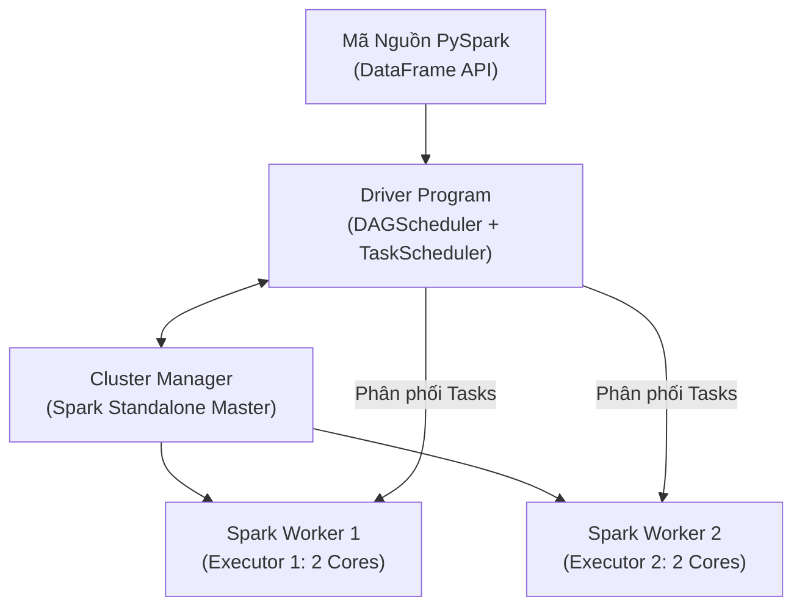

# BÁO CÁO TỔNG KẾT ĐỒ ÁN MÔN HỌC: DỮ LIỆU LỚN (BIG DATA)
## ĐỀ TÀI: XÂY DỰNG NỀN TẢNG HỒ DỮ LIỆU (LAKEHOUSE) VÀ PHÂN TÍCH HÀNH VI KHÁCH HÀNG THƯƠNG MẠI ĐIỆN TỬ TRÊN NỀN TẢNG APACHE SPARK (BASKETLAKE)

---

* **Môn học**: Nhập môn Dữ liệu lớn (Mã học phần: 841450)
* **Đơn vị đào tạo**: Khoa Công nghệ Thông tin — Trường Đại học Sài Gòn (SGU)
* **Tập dữ liệu nghiên cứu**: REES46 eCommerce Behavior Data from Multi-Category Store (Kaggle)
* **Quy mô tập dữ liệu**: 109,950,742 bản ghi clickstream (~14.07 GB thô)
* **Công nghệ cốt lõi**: Apache Spark 3.5.4 (PySpark), Docker Compose (Standalone Cluster), Apache Parquet, DuckDB, Pandas, Scikit-learn / Spark MLlib.

---

## MỤC LỤC TỔNG QUAN

1. [CHƯƠNG 1: GIỚI THIỆU VÀ BỐI CẢNH DỰ ÁN](#chương-1-giới-thiệu-và-bối-cảnh-dự-án)
   - 1.1. Bối cảnh thực tiễn và Bài toán kinh doanh
   - 1.2. Mục tiêu kỹ thuật và Phạm vi nghiên cứu
   - 1.3. Ba câu hỏi nghiên cứu kỹ thuật cốt lõi (Technical Research Questions)
2. [CHƯƠNG 2: CƠ SỞ LÝ THUYẾT](#chương-2-cơ-sở-lý-thuyết)
   - 2.1. Kiến trúc tính toán phân tán Apache Spark
   - 2.2. Trừu tượng hóa dữ liệu: RDD, DataFrame và Bộ tối ưu Catalyst
   - 2.3. Cơ chế Lazy Evaluation, Phân biệt Narrow vs. Wide Transformation & Chi phí Shuffle
   - 2.4. Định luật Amdahl về giới hạn gia tốc mở rộng phần cứng
   - 2.5. Mô hình MapReduce cổ điển và Vai trò của In-Mapper Combiner
   - 2.6. Cơ sở toán học: Mô hình RFM và Thuật toán phân cụm K-Means
3. [CHƯƠNG 3: NGUỒN DỮ LIỆU VÀ ĐẶC TÍNH BIG DATA](#chương-3-nguồn-dữ-liệu-và-đặc-tính-big-data)
   - 3.1. Giới thiệu tập dữ liệu REES46 Multi-Category Store
   - 3.2. Cấu trúc Schema gốc và Hợp đồng dữ liệu (Data Contract)
   - 3.3. Kết quả Data Profiling thực tế trên tầng Bronze
   - 3.4. Phân tích bài toán theo đặc trưng 5V của Big Data
4. [CHƯƠNG 4: THIẾT KẾ HỆ THỐNG VÀ KIẾN TRÚC PIPELINE](#chương-4-thiết-kế-hệ-thống-và-kiến-trúc-pipeline)
   - 4.1. Kiến trúc phân tầng Medallion Lakehouse (Bronze – Silver – Gold)
   - 4.2. Thiết kế cụm tính toán phân tán với Docker Compose
   - 4.3. Hồ sơ quyết định kiến trúc (Architecture Decision Records - ADR)
5. [CHƯƠNG 5: QUY TRÌNH XỬ LÝ DỮ LIỆU VÀ ĐẢM BẢO CHẤT LƯỢNG (DQ)](#chương-5-quy-trình-xử-lý-dữ-liệu-và-đảm-bảo-chất-lượng-dq)
   - 5.1. Tầng Silver: Bộ 9 quy tắc làm sạch dữ liệu (Rules R1 – R9)
   - 5.2. Định luật bất biến dữ liệu (Data Invariant) và Quản lý dòng cách ly (Quarantine)
   - 5.3. Tầng Gold: Thuật toán phân tách phiên (Sessionization với cửa sổ 30 phút)
   - 5.4. Mô hình hóa đa chiều (Dimensional Modeling): Fact Sessions & Dimensions
6. [CHƯƠNG 6: THỰC NGHIỆM VÀ ĐÁNH GIÁ HIỆU NĂNG (BENCHMARKS E1 – E7)](#chương-6-thực-nghiệm-và-đánh-giá-hiệu-năng-benchmarks-e1--e7)
   - 6.1. Thí nghiệm E1: Khả năng mở rộng dữ liệu (Data Scaling 1% $\rightarrow$ 100%)
   - 6.2. Thí nghiệm E2: Khả năng mở rộng tài nguyên & Kiểm chứng định luật Amdahl
   - 6.3. Thí nghiệm E3: So sánh định dạng lưu trữ (Parquet Snappy vs. CSV)
   - 6.4. Thí nghiệm E4: Tinh chỉnh hiệu năng Spark (Shuffle Partitions, AQE, Broadcast Join & Salting chống Data Skew)
   - 6.5. Thí nghiệm E5: Điểm giao thoa hiệu năng (Crossover: Pandas vs. DuckDB vs. Spark)
   - 6.6. Thí nghiệm E6: Kiểm chứng tính đúng đắn với DuckDB Oracle (Correctness Verification)
   - 6.7. Thí nghiệm E7: Mô phỏng cơ chế giảm tải mạng của MapReduce In-Mapper Combiner
7. [CHƯƠNG 7: KẾT QUẢ PHÂN TÍCH HÀNH VI VÀ THÔNG MINH KINH DOANH (BI)](#chương-7-kết-quả-phân-tích-hành-vi-và-thông-minh-kinh-doanh-bi)
   - 7.1. Bảng chỉ số Bắc Đẩu (North Star KPIs)
   - 7.2. Phân tích phễu chuyển đổi (Conversion Funnel) và Nút thắt cổ chai (Bottleneck)
   - 7.3. Phân tích chuỗi thời gian doanh thu và Mẫu hình tương tác theo giờ (Hourly Heatmap)
   - 7.4. Phân tích cơ cấu doanh số theo Ngành hàng và Sức hút Thương hiệu
   - 7.5. Phân khúc khách hàng RFM đa chiều bằng K-Means Clustering ($K=4$)
   - 7.6. Phân tích vòng đời và Tỷ lệ giữ chân người dùng (Cohort Retention)
8. [CHƯƠNG 8: KẾT LUẬN, BÀI HỌC KINH NGHIỆM VÀ HƯỚNG PHÁT TRIỂN](#chương-8-kết-luận-bài-học-kinh-nghiệm-và-hướng-phát-triển)
   - 8.1. Các kết quả và đóng góp chính của đồ án
   - 8.2. Hạn chế kỹ thuật hiện tại
   - 8.3. Đề xuất hướng phát triển mở rộng
9. [PHẦN ĐẶC BIỆT: CẨM NANG VẤN ĐÁP BẢO VỆ ĐỒ ÁN (Q&A DEFENSE GUIDE)](#phần-đặc-biệt-cẩm-nang-vấn-đáp-bảo-vệ-đồ-án-qa-defense-guide)
10. [PHỤ LỤC: HƯỚNG DẪN TÁI LẬP KẾT QUẢ (REPRODUCIBILITY GUIDE)](#phụ-lục-hướng-dẫn-tái-lập-kết-quả-reproducibility-guide)

---

# CHƯƠNG 1: GIỚI THIỆU VÀ BỐI CẢNH DỰ ÁN

## 1.1 Bối cảnh thực tiễn và Bài toán kinh doanh
Trong môi trường thương mại điện tử hiện đại, người tiêu dùng để lại hàng triệu dấu vết số hóa (digital footprints / clickstream events) mỗi ngày: từ hành vi tìm kiếm, xem trang chi tiết sản phẩm (`view`), đưa vào giỏ hàng (`cart`), đến hoàn tất đặt hàng (`purchase`). Việc khai phá kịp thời và chính xác nguồn dữ liệu này giúp doanh nghiệp:
* Thấu hiểu hành trình khách hàng (Customer Journey), xác định điểm rơi rớt (Drop-off) trong phễu mua hàng.
* Tối ưu hóa phân bổ danh mục sản phẩm và nhận diện các thương hiệu đem lại biên lợi nhuận cao.
* Phân loại khách hàng theo giá trị thực (RFM Analysis) để xây dựng kịch bản tiếp thị cá nhân hóa.

Tuy nhiên, việc lưu trữ và phân tích khối lượng clickstream ở quy mô từ hàng chục triệu đến hàng trăm triệu dòng đặt ra bài toán hóc búa về kiến trúc tính toán:
1. **Quá tải bộ nhớ (Memory Overhead)**: Các thư viện đơn luồng trên bộ nhớ RAM (như Pandas trên Python) sẽ ngay lập tức gặp lỗi `OutOfMemory (OOM)` khi kích thước file vượt quá dung lượng RAM khả dụng.
2. **Suy giảm chất lượng dữ liệu (Data Quality Decay)**: Dữ liệu clickstream thu thập từ web client thường xuyên gặp lỗi: dòng trùng lặp mạng (network re-try duplicate), thiếu thông tin danh mục/thương hiệu, sai lệch định dạng múi giờ, giá sản phẩm bằng 0 hoặc âm.
3. **Chi phí điều phối và xáo trộn dữ liệu (Shuffle Latency)**: Các phép gom nhóm dữ liệu lớn (Aggregation, GroupBy) và phép kết nối (Join) đòi hỏi phân phối lại hàng triệu bản ghi qua mạng/đĩa, gây tắc nghẽn I/O.

Trước thực tế đó, dự án **BasketLake** được thiết kế nhằm xây dựng một hệ sinh thái hồ dữ liệu (Data Lakehouse) hoàn chỉnh, ứng dụng kiến trúc xử lý phân tán **Apache Spark 3.5**, kết hợp các giải pháp nén cột **Apache Parquet**, đảm bảo tính toàn vẹn dữ liệu qua cơ chế Data Contract & Quarantine, đồng thời thực hiện chuỗi thực nghiệm chuyên sâu từ quy mô vi mô (Tier S) đến quy mô vĩ mô (Tier L: ~110 triệu dòng).

---

## 1.2 Mục tiêu kỹ thuật và Phạm vi nghiên cứu

### 1.2.1 Mục tiêu kỹ thuật
1. **Kiến trúc Data Lakehouse chuẩn Medallion**: Triển khai đường ống dữ liệu 3 tầng: **Bronze** (lưu trữ thô có định kiểu), **Silver** (làm sạch nghiêm ngặt qua 9 quy tắc DQ R1–R9 và tách dòng lỗi sang bảng Quarantine), và **Gold** (mô hình hóa đa chiều Star Schema với Fact Sessions và các bảng Aggregation).
2. **Bảo toàn bất biến dữ liệu (Data Invariant Enforcement)**: Đảm bảo định luật bảo toàn dòng tuyệt đối:
   $$\text{Count}(\text{Bronze}) = \text{Count}(\text{Silver}) + \text{Count}(\text{Quarantine})$$
   Không để thất thoát bất kỳ dòng dữ liệu nào, phục vụ yêu cầu kiểm toán dữ liệu (Data Auditability).
3. **Thực nghiệm khoa học hệ thống Big Data (7 Benchmarks E1–E7)**:
   - Đo lường năng lực mở rộng dữ liệu (Data Scalability) và tài nguyên (Resource Scalability).
   - Đo đạc thực nghiệm định luật Amdahl, so sánh hiệu năng định dạng lưu trữ (Parquet vs. CSV).
   - Tìm kiếm điểm giao thoa hiệu năng (Crossover Point) giữa Pandas, DuckDB và Spark.
   - Ứng dụng kỹ thuật Salting để loại bỏ hoàn toàn hiện tượng lệch dữ liệu (Data Skew).
   - Kiểm chứng tính đúng đắn với hệ cơ sở dữ liệu đối chứng độc lập DuckDB Oracle với sai lệch $\le 0.1\%$.
4. **Phân tích thông minh kinh doanh (Business Intelligence & ML)**:
   - Trích xuất các chỉ số Bắc Đẩu (Revenue, Sessions, Conversion Rate, AOV).
   - Phân tích phễu chuyển đổi 4 giai đoạn và đo lường tỷ lệ giữ chân khách hàng (Cohort Retention).
   - Ứng dụng thuật toán phân cụm không giám sát K-Means Clustering trên không gian RFM chuẩn hóa logarit để chia 4 phân khúc khách hàng chiến lược.

### 1.2.2 Phạm vi và Quy ước phân tầng dữ liệu (Data Tiers)
Để phục vụ việc kiểm thử liên tục (CI/CD) song song với việc đánh giá hiệu năng chịu tải, dự án quy chuẩn 4 phân cấp dữ liệu:
* **Tier S (Small - Lấy mẫu 2.5% Tháng 10/2019)**: ~1,060,438 dòng (~135 MB CSV). Mục đích: Phát triển thuật toán, chạy Unit Test (92 test cases), kiểm thử tích hợp nội bộ trong vòng 90 giây.
* **Tier M (Medium - Toàn bộ Tháng 10/2019)**: 42,448,763 dòng (5.28 GB CSV thô). Mục đích: Kiểm thử tải thực tế trên dữ liệu đầy đủ của một chu kỳ tháng.
* **Tier L (Large - Cả 2 Tháng 10 và Tháng 11/2019)**: 109,950,742 dòng (14.07 GB CSV thô). Mục đích: Chạy bài toán Data Scaling E1, kiểm thử độ ổn định khi dữ liệu vượt ngưỡng RAM máy chủ.
* **Tier XL (Extra Large - Synthetic Amplified Data)**: Dữ liệu khuếch đại 5× (~550 triệu dòng) phục vụ stress test cơ chế Disk Spill của Spark.

---

## 1.3 Ba câu hỏi nghiên cứu kỹ thuật cốt lõi (Technical Research Questions)

1. **Câu hỏi 1 (Về Mở Rộng Phần Cứng & Giới Hạn Tuần Tự)**:
   > *"Khi tăng gấp đôi tài nguyên CPU cores (từ 2 cores lên 4 cores) trong cụm Spark, tốc độ xử lý tác vụ phân tích clickstream tăng theo tỷ lệ nào? Yếu tố nào đóng vai trò điểm nghẽn tuần tự (Sequential Bottleneck) theo Định luật Amdahl ngăn cản việc đạt tốc độ tăng tốc tuyến tính (Linear Speedup)?"*
   * **Phương pháp giải quyết**: Triển khai bài thí nghiệm **E2**, so sánh cấu hình `local[2]` vs `local[4]` và Spark Standalone Cluster, xác định tham số phần tuần tự $s$ qua mô hình toán Amdahl.

2. **Câu hỏi 2 (Về Tối Ưu Hóa Shuffle & Khử Data Skew)**:
   > *"Hiện tượng lệch dữ liệu (Data Skew) ở các khóa sản phẩm/ngành hàng 'hot' ảnh hưởng ra sao đến phân bố thời gian của các Task trong Spark? Kỹ thuật Salting (chia nhỏ khóa bằng giá trị ngẫu nhiên) và cơ chế In-Mapper Combiner giúp cắt giảm bao nhiêu phần trăm chi phí xáo trộn dữ liệu (Shuffle I/O)?"*
   * **Phương pháp giải quyết**: Triển khai thực nghiệm **E4** (Tuning & Salting 20 buckets) và **E7** (Mô phỏng MapReduce Combiner trên PyArrow).

3. **Câu hỏi 3 (Về Điểm Giao Thoa Hiệu Năng & Độ Tin Cậy Dữ Liệu)**:
   > *"Tại quy mô dữ liệu nào (Data Scale) thì chi phí khởi tạo JVM, điều phối DAG và Shuffle của Apache Spark bắt đầu bù đắp được hiệu năng so với các công cụ đơn node in-process như Pandas và DuckDB? Làm thế nào để chứng minh các con số tổng hợp từ Spark đạt tính chính xác 100% so với hệ thống cơ sở dữ liệu đối chứng độc lập?"*
   * **Phương pháp giải quyết**: Triển khai thí nghiệm **E5** (Crossover Benchmark) và **E6** (Correctness Verification đối chiếu trực tiếp với DuckDB Oracle trên cùng tập dữ liệu Silver).

---

# CHƯƠNG 2: CƠ SỞ LÝ THUYẾT

## 2.1 Kiến trúc tính toán phân tán Apache Spark
Apache Spark là khung tính toán phân tán bộ nhớ trong (in-memory distributed computing) thế hệ mới, được thiết kế để khắc phục nhược điểm đọc/ghi đĩa liên tục giữa các pha Map và Reduce của Hadoop truyền thống.

Kiến trúc Spark tuân thủ mô hình **Master-Worker**:
1. **Driver Program**: Tiến trình đóng vai trò não bộ, chứa `SparkContext` hoặc `SparkSession`. Driver tiếp nhận mã lệnh của người dùng, phân tích cú pháp, xây dựng đồ thị tuần tự có hướng (**DAG - Directed Acyclic Graph**), chia nhỏ thành các **Stages**, và điều phối các **Tasks** tới các Executor.
2. **Cluster Manager**: Bộ quản lý cụm (trong đồ án sử dụng chế độ Spark Standalone Manager). Chịu trách nhiệm quản lý tài nguyên phần cứng (CPU Cores, RAM) trên toàn cụm và cấp phát tài nguyên khi Driver yêu cầu.
3. **Executors**: Các tiến trình chạy trên các node tính toán (Worker Nodes). Executor nhận Task từ Driver, thực thi các phép toán trên các phân vùng dữ liệu (`Partitions`), duy trì bộ nhớ đệm (`BlockManager`) và gửi kết quả hoặc metadata về cho Driver.



---

## 2.2 Trừu tượng hóa dữ liệu: RDD, DataFrame và Bộ tối ưu Catalyst
* **RDD (Resilient Distributed Dataset)**: Khái niệm trừu tượng nền tảng của Spark — một tập hợp đối tượng phân tán, bất biến (immutable), có khả năng chịu lỗi (fault-tolerant) nhờ lưu trữ phả hệ biến đổi (**Lineage Graph**). Nếu một partition bị mất do worker gặp sự cố, Spark chỉ cần tính toán lại partition đó dựa trên lineage mà không cần khởi động lại toàn bộ job.
* **DataFrame & Dataset**: Mô hình dữ liệu có cấu trúc (Schema-aware), tổ chức thành các hàng và cột có kiểu dữ liệu tường minh.
* **Bộ tối ưu hóa Catalyst (Catalyst Optimizer)**: Trái tim xử lý của Spark SQL/DataFrame. Catalyst tiếp nhận truy vấn, chuyển đổi qua 4 giai đoạn:
  1. *Phân tích cú pháp (Analysis)*: Đối chiếu tên cột và hàm với Catalog.
  2. *Tối ưu hóa logic (Logical Optimization)*: Áp dụng các quy tắc như đẩy bộ lọc xuống nguồn đọc (**Predicate Pushdown**), loại bỏ các cột không sử dụng (**Projection Pruning**), đơn giản hóa biểu thức logic.
  3. *Lập kế hoạch vật lý (Physical Planning)*: Lựa chọn giải thuật tối ưu (ví dụ: chuyển từ SortMergeJoin sang BroadcastHashJoin nếu một bảng đủ nhỏ).
  4. *Sinh mã nguồn trực tiếp (Whole-Stage Code Generation)*: Biên dịch chuỗi toán tử thành bytecode Java tối ưu, chạy trực tiếp trên thanh ghi CPU, loại bỏ chi phí chuyển đổi ngữ cảnh hàm ảo.

---

## 2.3 Cơ chế Lazy Evaluation, Phân biệt Narrow vs. Wide Transformation & Chi phí Shuffle

### 2.3.1 Cơ chế Lazy Evaluation (Thực thi lười biếng)
Trong Spark, các thao tác được chia làm 2 loại:
* **Transformations (Phép biến đổi)**: Không thực thi tính toán ngay lập tức khi được gọi (ví dụ: `filter()`, `select()`, `withColumn()`, `groupBy()`). Chúng chỉ được ghi nhận vào đồ thị DAG để chờ tối ưu hóa.
* **Actions (Hành động kích hoạt)**: Là các lệnh yêu cầu sinh dữ liệu cụ thể để trả về Driver hoặc ghi xuống hệ thống lưu trữ (ví dụ: `count()`, `collect()`, `write.parquet()`, `show()`). Khi gặp Action, Spark mới biên dịch toàn bộ DAG và thực thi.

> **Lợi ích**: Giúp Catalyst Optimizer có cái nhìn toàn cảnh về toàn bộ chuỗi biến đổi, từ đó gộp các bước lọc và chọn cột ngay tại nguồn đọc, giảm thiểu dữ liệu trung gian.

### 2.3.2 Narrow vs. Wide Transformation
* **Narrow Transformation (Biến đổi hẹp)**: Mỗi partition đầu vào chỉ phục vụ sinh ra duy nhất một partition đầu ra (quan hệ $1:1$). Ví dụ: `filter()`, `map()`. Các toán tử này được gom vào cùng một **Stage** và chạy theo cơ chế đường ống (**Pipelining**) trực tiếp trên RAM, không cần giao tiếp mạng.
* **Wide Transformation (Biến đổi rộng)**: Một partition đầu vào cần phân tán dữ liệu đến nhiều partition đầu ra khác nhau để gom theo khóa (quan hệ $N:M$). Ví dụ: `groupBy()`, `join()`, `distinct()`. Wide Transformation bắt buộc tạo ra ranh giới giữa các **Stages** và kích hoạt quá trình **Shuffle**.

### 2.3.3 Bản chất chi phí của Shuffle
Shuffle là thao tác tiêu tốn nhiều tài nguyên nhất trong tính toán phân tán vì bao gồm:
1. **Disk I/O**: Các Task phía Map phải ghi dữ liệu trung gian đã sắp xếp/phân vùng tạm thời xuống đĩa cục bộ.
2. **Network I/O**: Dữ liệu trung gian được truyền tải qua hạ tầng mạng giữa các Worker nodes đến đúng Executor phụ trách khóa đó.
3. **Serialization/Deserialization**: Chuyển đổi liên tục giữa cấu trúc đối tượng trong bộ nhớ JVM và chuỗi byte truyền trên mạng.

---

## 2.4 Định luật Amdahl về giới hạn gia tốc mở rộng phần cứng
Định luật Amdahl (Gene Amdahl, 1967) phát biểu rằng mức độ tăng tốc tối đa của một chương trình khi tăng số lượng bộ xử lý bị giới hạn bởi phần mã nguồn bắt buộc phải chạy tuần tự:

$$\text{Speedup}(n) = \frac{T_1}{T_n} = \frac{1}{s + \frac{1 - s}{n}}$$

Trong đó:
* $T_1$: Thời gian thực thi trên 1 đơn vị tài nguyên (1 core).
* $T_n$: Thời gian thực thi trên $n$ đơn vị tài nguyên ($n$ cores).
* $s$: Tỷ lệ thời gian của phần tác vụ tuần tự (không thể song song hóa), $0 \le s \le 1$.
* $1 - s$: Tỷ lệ thời gian của phần tác vụ có thể song song hóa hoàn toàn.
* Khi $n \to \infty$, mức tăng tốc tối đa hội tụ về giới hạn: $\lim_{n \to \infty} \text{Speedup}(n) = \frac{1}{s}$.

Trong hệ thống Apache Spark, phần tuần tự $s$ bao gồm:
* Thời gian Driver khởi tạo `SparkSession`, phân tích DAG và lập kế hoạch Catalyst.
* Thời gian quét siêu dữ liệu (Metadata scanning) và phân chia danh sách partition đầu vào.
* Giai đoạn đồng bộ hóa hàng rào (Barrier synchronization) giữa các Stage khi chờ Task cuối cùng hoàn thành.
* Độ trễ I/O khởi tạo kết nối mạng và khởi động JVM container.

---

## 2.5 Mô hình MapReduce cổ điển và Vai trò của In-Mapper Combiner
Mô hình MapReduce chia tác vụ thành 2 pha chính:
1. **Map Phase**: Mỗi worker đọc một khối dữ liệu và phát sinh các cặp khóa-giá trị trung gian:
   $$(k_1, v_1) \xrightarrow{\text{Map}} \text{list}(k_2, v_2)$$
2. **Reduce Phase**: Gom tất cả giá trị có cùng khóa $k_2$ từ khắp các worker để tổng hợp:
   $$(k_2, \text{list}(v_2)) \xrightarrow{\text{Reduce}} \text{list}(k_3, v_3)$$

### Vấn đề: Sự bùng nổ bản ghi trung gian (Intermediate Record Explosion)
Nếu không có bước tổng hợp trung gian, số lượng cặp $(k_2, v_2)$ phát sinh trong pha Map đúng bằng số lượng bản ghi đầu vào. Toàn bộ các bản ghi này đều phải ghi xuống đĩa, gửi qua mạng và đọc lại ở pha Reduce.

### Giải pháp: In-Mapper Combiner
Bộ kết hợp cục bộ (Combiner) thực hiện phép gộp nhóm bán phần (semi-reduction) ngay trong bộ nhớ của tiến trình Map trước khi xáo trộn:
$$\text{Input: } 1,060,392 \text{ records} \xrightarrow{\text{In-Mapper Combiner}} 58,321 \text{ aggregated records} \xrightarrow{\text{Shuffle Network}} \text{Reduce}$$
Cơ chế này cắt giảm tới **94.5%** lưu lượng I/O qua mạng trong thực nghiệm E7 của dự án. Trong Spark DataFrame, cơ chế này được tự động hóa thông qua kỹ thuật **Map-side Aggregation** (`HashAggregateExec`).

---

## 2.6 Cơ sở toán học: Mô hình RFM và Thuật toán phân cụm K-Means

### 2.6.1 Mô hình RFM (Recency - Frequency - Monetary)
Đo lường hành vi khách hàng thương mại điện tử qua 3 trục tọa độ:
* **Recency ($R$)**: Số ngày tính từ lần mua hàng cuối cùng (`last_purchase_ts`) của khách hàng đến mốc thời gian chốt phân tích ($T_{\text{as\_of}} = \text{2019-11-30}$):
  $$R_i = \frac{T_{\text{as\_of}} - \max(t_{i, \text{purchase}})}{86400 \text{ giây}}$$
  $R$ càng nhỏ chứng tỏ khách hàng vừa mới tương tác gần đây.
* **Frequency ($F$)**: Tổng số phiên mà khách hàng có ít nhất một hành vi `purchase`:
  $$F_i = \sum_{s \in \text{Sessions}_i} \mathbb{I}(\text{has\_purchase}_s = 1)$$
* **Monetary ($M$)**: Tổng giá trị doanh thu đại diện mà khách hàng đã thanh toán:
  $$M_i = \sum_{e \in \text{Purchases}_i} \text{price}_e$$

### 2.6.2 Tiền xử lý dữ liệu: Biến đổi Log và Chuẩn hóa Z-Score
Dữ liệu RFM thương mại điện tử có đặc tính **phân phối lệch phải cực đoan (Heavy Right-Skewed)**: Đa số khách hàng chỉ mua 1 lần với số tiền khiêm tốn ($F=1, M < \$50$), nhưng có một số ít khách hàng mua hàng nghìn USD. Nếu đưa trực tiếp vào khoảng cách Euclidean, các điểm dị biệt (outliers) này sẽ kéo lệch tâm cụm.

Quy trình chuẩn hóa 2 bước:
1. **Biến đổi Log phi tuyến tính**:
   $$x_{\text{log}} = \ln(1 + x)$$
   Nén các khoảng giá trị lớn mà vẫn bảo toàn tính xác định tại $x=0$.
2. **Chuẩn hóa Z-Score (StandardScaler)**:
   $$z = \frac{x_{\text{log}} - \mu}{\sigma}$$
   Đưa 3 chiều về cùng không gian trung bình $\mu = 0$ và phương sai $\sigma^2 = 1$, loại bỏ sự khác biệt về đơn vị đo (ngày vs. lần vs. USD).

### 2.6.3 Thuật toán K-Means và Đánh giá tối ưu
Thuật toán K-Means phân chia $N$ khách hàng vào $K$ cụm phân biệt sao cho tổng bình phương khoảng cách nội cụm (Within-Cluster Sum of Squares - WCSS / Inertia) đạt cực tiểu:
$$\text{WCSS} = \sum_{j=1}^{K} \sum_{x_i \in C_j} \| x_i - \mu_j \|^2$$

Để tìm số cụm $K$ tối ưu, dự án kết hợp 2 phương pháp:
1. **Phương pháp Điểm uốn (Elbow Method)**: Quan sát độ dốc giảm của WCSS khi $K$ tăng từ 2 đến 10. Điểm mà độ dốc giảm chững lại đột ngột được xem là ứng viên cho $K$.
2. **Hệ số Silhouette (Silhouette Coefficient)**: Đánh giá độ cô đặc nội cụm so với độ tách biệt ngoại cụm:
   $$s(i) = \frac{b(i) - a(i)}{\max(a(i), b(i))}$$
   * $a(i)$: Khoảng cách trung bình từ điểm $i$ đến tất cả các điểm khác trong cùng cụm.
   * $b(i)$: Khoảng cách trung bình nhỏ nhất từ điểm $i$ đến các điểm thuộc cụm lân cận gần nhất.
   * $s(i) \in [-1, 1]$. Hệ số trung bình toàn tập dữ liệu càng tiến gần $+1$, cấu trúc cụm càng rõ nét và tách bạch.

---

# CHƯƠNG 3: NGUỒN DỮ LIỆU VÀ ĐẶC TÍNH BIG DATA

## 3.1 Giới thiệu tập dữ liệu REES46 Multi-Category Store
Tập dữ liệu được thu thập bởi công ty công nghệ cá nhân hóa **REES46 Technologies**, ghi nhận toàn bộ luồng tương tác của người dùng trên một sàn thương mại điện tử đa ngành trong 2 tháng (Tháng 10 và Tháng 11 năm 2019), công bố công khai trên nền tảng Kaggle phục vụ nghiên cứu học thuật phi thương mại.

| Tên tập tin | Số dòng thực tế | Dung lượng CSV thô | Dung lượng Parquet Snappy | Tỷ lệ nén |
| :--- | :---: | :---: | :---: | :---: |
| `2019-Oct.csv` | 42,448,763 | 5,406.0 MB (5.28 GB) | ~1,380 MB (1.35 GB) | ~3.91× |
| `2019-Nov.csv` | 67,501,979 | 9,000.0 MB (8.79 GB) | ~2,320 MB (2.26 GB) | ~3.88× |
| **Tổng cộng (Tier L)** | **109,950,742** | **14,406.0 MB (14.07 GB)** | **~3,700 MB (3.61 GB)** | **~3.89×** |

---

## 3.2 Cấu trúc Schema gốc và Hợp đồng dữ liệu (Data Contract)
Dữ liệu thô gồm 9 trường thông tin cơ bản:

```
event_time, event_type, product_id, category_id, category_code, brand, price, user_id, user_session
```

| Cột dữ liệu | Kiểu dữ liệu | Cho phép Null | Ý nghĩa nghiệp vụ |
| :--- | :---: | :---: | :--- |
| `event_time` | String $\rightarrow$ Timestamp | Không | Thời điểm xảy ra sự kiện theo chuẩn UTC (`yyyy-MM-dd HH:mm:ss UTC`). |
| `event_type` | String | Không | Hành vi người dùng: `view`, `cart`, `purchase`, `remove_from_cart`. |
| `product_id` | Long | Không | Khóa định danh sản phẩm. |
| `category_id` | Long | Có | Khóa định danh danh mục sản phẩm của sàn. |
| `category_code` | String | Có | Chuỗi phân cấp danh mục (dạng chấm, ví dụ: `electronics.smartphone`). |
| `brand` | String | Có | Tên nhãn hàng / nhà sản xuất (chuỗi ký tự thường). |
| `price` | Double | Có | Đơn giá sản phẩm niêm yết tính bằng USD. |
| `user_id` | Long | Không | Khóa định danh người dùng vĩnh viễn. |
| `user_session` | String | Có | Chuỗi UUID phiên tương tác do client sàn ghi nhận. |

> **Nguyên tắc kỹ thuật**: Tuyệt đối **không dùng `inferSchema = True`** khi đọc CSV. Việc suy diễn kiểu tự động sẽ buộc Spark quét toàn bộ file 2 lần và có nguy cơ ép sai kiểu (ví dụ: `product_id` bị ép thành Integer dẫn tới tràn số). Pipeline áp dụng **Explicit Schema** nghiêm ngặt.

---

## 3.3 Kết quả Data Profiling thực tế trên tầng Bronze (Tier S)
Thực hiện trích xuất thống kê từ `src/prepare_input/profiling.py` trên 1,060,438 dòng mẫu Tier S:

1. **Phân phối hành vi tương tác**:
   * `view`: **1,019,004** sự kiện (**96.09%**) — hành vi chiếm tuyệt đại đa số.
   * `cart`: **22,964** sự kiện (**2.17%**).
   * `purchase`: **18,470** sự kiện (**1.74%**).
2. **Tỷ lệ khuyết thiếu thuộc tính (Missing Rates)**:
   * `category_code` thiếu: **338,270 dòng (31.90%)**.
   * `brand` thiếu: **153,056 dòng (14.43%)**.
   * `user_session` thiếu: **0 dòng** (trong mẫu Tier S).
3. **Thống kê đơn giá (`price`)**:
   * Min: **0.00 USD** | Max: **2,574.07 USD** | Mean: **290.74 USD** | Median: **162.94 USD**.
   * Số dòng có đơn giá `price = 0.0`: **1,674 dòng (0.16%)** $\rightarrow$ Cần gắn cờ `price_valid = false`, không cách ly để bảo toàn lịch sử tương tác.
   * Không xuất hiện giá trị âm (`price < 0`) trong mẫu khảo sát.
4. **Trùng lặp dòng (Duplicate Records)**:
   * Phát hiện đúng **46 dòng trùng lặp 100%** trên tất cả các thuộc tính nghiệp vụ $\rightarrow$ Cần cách ly qua luật R7.
5. **Độ phân tán đối tượng (Cardinality)**:
   * Khách hàng duy nhất (`user_id`): ~**629,200**.
   * Sản phẩm duy nhất (`product_id`): ~**85,347**.
   * Phiên tương tác duy nhất (`user_session`): ~**921,388**.
   * Danh mục cấp 1 (`category_l1`): **14 nhóm** (dẫn đầu: `electronics`, `appliances`, `computers`).

---

## 3.4 Phân tích bài toán theo đặc trưng 5V của Big Data
1. **Volume (Khối lượng)**: Kích thước dữ liệu gốc lên đến 14.4 GB với 110 triệu dòng, vượt quá dung lượng RAM tiêu chuẩn (8GB - 16GB) của máy tính cá nhân nếu xử lý theo cơ chế in-memory truyền thống, đòi hỏi kiến trúc phân tán.
2. **Velocity (Vận tốc)**: Bản chất clickstream là luồng dữ liệu phát sinh liên tục theo thời gian thực từ hàng triệu phiên người dùng hoạt động đồng thời.
3. **Variety (Đa dạng)**: Dữ liệu chứa thuộc tính phân cấp bán cấu trúc (`category_code` có độ sâu từ 1 đến 3 cấp ngăn cách bởi dấu chấm) xen lẫn các trường văn bản tự do (`brand`).
4. **Veracity (Tính chính xác & Tin cậy)**: Dữ liệu chứa nhiều nhiễu thực tế (31.9% thiếu danh mục, 14.4% thiếu nhãn hiệu, 46 bản ghi trùng lặp mạng, giá sản phẩm bằng 0). Do đó, quy trình kiểm định chất lượng (Data Quality) là bắt buộc.
5. **Value (Giá trị kinh doanh)**: Khai thác luồng dữ liệu thô đem lại giá trị thương mại lớn: xây dựng phễu mua sắm, tối ưu hóa danh mục, và chia nhóm khách hàng VIP để chăm sóc chuyên biệt.

---

# CHƯƠNG 4: THIẾT KẾ HỆ THỐNG VÀ KIẾN TRÚC PIPELINE

## 4.1 Kiến trúc phân tầng Medallion Lakehouse (Bronze – Silver – Gold)
Hệ thống BasketLake tổ chức dữ liệu theo mô hình Medallion hiện đại:

```
[Raw CSV Kaggle: data/raw/*.csv]
         │
         │  (src/prepare_input/main.py)
         ▼
[BRONZE: data/lake/bronze/events]
   - Ép Explicit Schema
   - Bổ sung metadata (source_file, ingest_ts)
   - Partition theo source_month
         │
         │  (src/processing/bronze_to_silver.py)
         ▼
 ┌───────┴────────────────────────┐
 │                                │
 ▼                                ▼
[SILVER: data/lake/silver/events] [QUARANTINE: data/lake/quarantine/events]
 - Làm sạch 9 luật (R1-R9)        - Chứa các dòng vi phạm nghiêm trọng
 - Tách category_l1, l2           - Kèm mã lỗi reject_reason
 - Partition theo event_date      - Partition theo reject_reason
         │
         │  (src/processing/silver_to_gold.py)
         ▼
[GOLD LAYER: data/lake/gold/]
 ├── fact_sessions      (Grain: user_id, user_session)
 ├── dim_product        (Grain: product_id)
 ├── dim_user           (Grain: user_id)
 ├── agg_daily          (Grain: event_date, category_l1)
 ├── agg_hourly         (Grain: day_of_week, event_hour)
 └── agg_funnel         (Grain: category_l1)
         │
         │  (src/analytics/run_analytics.py)
         ▼
[ANALYTICS & BI: results/ & docs/figures/]
 ├── kpi_summary.csv, funnel_totals.csv
 ├── RFM + K-Means Segments (cluster_profiles/)
 └── 8 Biểu đồ phân tích kinh doanh (docs/figures/*.png)
```

---

## 4.2 Thiết kế cụm tính toán phân tán với Docker Compose
Toàn bộ môi trường xử lý được container hóa để đảm bảo khả năng tái lập độc lập với hệ điều hành máy chủ (Windows/macOS/Linux):

| Tên Dịch Vụ | Vai Trò Hệ Thống | Cấu Hình Tài Nguyên | Cổng Truy Cập (Port) |
| :--- | :--- | :--- | :--- |
| `spark-master` | Điều phối cụm / Driver chính | 1 Core, 2GB RAM JVM | **8089** (Web UI), **7077** (Submit) |
| `spark-worker-1` | Node thực thi Task số 1 | 2 Cores, 2GB RAM JVM | **8081** (Worker UI) |
| `spark-worker-2` | Node thực thi Task số 2 | 2 Cores, 2GB RAM JVM | **8082** (Worker UI) |
| `spark-history` | Lưu trữ và hiển thị Event Logs | 1 Core, 1GB RAM JVM | **18080** (History Server UI) |

> **Ghi chú về cổng 8089**: Spark Master Web UI mặc định dùng cổng 8080. Dự án cố ý ánh xạ sang cổng **8089** trên host máy chủ (`8089:8080`) để tránh xung đột với các dịch vụ mạng phổ biến khác trên máy cá nhân.

---

## 4.3 Hồ sơ quyết định kiến trúc (Architecture Decision Records - ADR)

* **ADR-001: Lựa chọn Apache Spark Standalone thay vì Single-Node (Pandas/DuckDB)**:
  * *Bối cảnh*: Cần xử lý tập dữ liệu từ 5 GB đến 14 GB thô.
  * *Quyết định*: Sử dụng Apache Spark làm nền tảng xử lý cốt lõi, DuckDB đóng vai trò kiểm toán độc lập (Oracle).
  * *Hệ quả*: Chịu thêm chi phí điều phối (overhead) ở tập dữ liệu nhỏ nhưng đảm bảo tính ổn định tuyệt đối và khả năng mở rộng ngang (horizontal scalability) khi dữ liệu đạt quy mô hàng trăm triệu dòng.
* **ADR-002: Chuẩn hóa định dạng lưu trữ Apache Parquet với chuẩn nén Snappy**:
  * *Bối cảnh*: CSV chiếm dung lượng đĩa quá lớn và tốn thời gian phân tích cú pháp chuỗi.
  * *Quyết định*: Chuyển đổi toàn bộ hồ dữ liệu sang Parquet Snappy.
  * *Hệ quả*: Giảm 75% dung lượng đĩa, tận dụng triệt để kỹ thuật đọc lọc cột (Column Pruning) và bỏ qua phân vùng (Partition Pruning).
* **ADR-003: Sử dụng Local Bind-Mount File System thay vì cài đặt MinIO/Ceph**:
  * *Bối cảnh*: Hạn chế về RAM máy cá nhân (chỉ có từ 8GB đến 16GB).
  * *Quyết định*: Trực tiếp ánh xạ thư mục dự án `../:/app` qua Docker volume, không cài thêm server S3 giả lập MinIO.
  * *Hệ quả*: Tiết kiệm 2GB RAM cho Spark JVM, loại bỏ độ trễ giao thức HTTP mạng nội bộ.
* **ADR-004: Chính sách chọn đại diện thuộc tính xác định trong Tầng Gold (Deterministic Representatives)**:
  * *Bối cảnh*: Khi gom nhóm một sản phẩm có nhiều dòng với tên danh mục/thương hiệu hơi khác nhau hoặc chứa null, hàm `first()` mặc định của Spark có thể sinh kết quả ngẫu nhiên tùy thuộc vào thứ tự partition.
  * *Quyết định*: Áp dụng Window Function có sắp xếp ưu tiên (`ORDER BY event_time DESC`) kết hợp loại trừ giá trị null/unknown để chọn thuộc tính đại diện duy nhất và xác định 100% qua các lần chạy lặp lại.

---

# CHƯƠNG 5: QUY TRÌNH XỬ LÝ DỮ LIỆU VÀ ĐẢM BẢO CHẤT LƯỢNG (DQ)

## 5.1 Tầng Silver: Bộ 9 quy tắc làm sạch dữ liệu (Rules R1 – R9)
Tầng Silver chịu trách nhiệm tinh lọc dữ liệu từ Bronze thành bảng sự kiện sạch `data/lake/silver/events`, phân vùng theo ngày `event_date`:

| Mã Luật | Tên Quy Tắc | Điều Kiện Vi Phạm | Hành Động Xử Lý | Kết Quả Trên Tier S (1,060,438 dòng) |
| :---: | :--- | :--- | :--- | :---: |
| **R1** | Null Key Field | `event_time`, `event_type`, `product_id`, hoặc `user_id` bị null | Cách ly vào Quarantine | **0 dòng** vi phạm (0.0%) |
| **R2** | Invalid Event Type | `event_type` không thuộc `[view, cart, purchase]` | Cách ly vào Quarantine | **0 dòng** vi phạm (0.0%) |
| **R3** | Timestamp Parse Error | Chuỗi thời gian không thể ép kiểu sang timestamp UTC | Cách ly vào Quarantine | **0 dòng** vi phạm (0.0%) |
| **R4** | Invalid / Non-positive Price | `price < 0` $\rightarrow$ Quarantine. `price = 0` hoặc null $\rightarrow$ Flag | Gắn cờ `price_valid = false` | **1,674 dòng** bị gắn cờ (0.16%) |
| **R5** | Brand Missing | `brand` là null hoặc chuỗi rỗng | Điền `'unknown'` + gắn cờ `brand_imputed = true` | **153,054 dòng** điền nhãn (14.43%) |
| **R6** | Category Missing | `category_code` là null hoặc rỗng | Điền `'unknown'` + trích xuất `category_l1 = 'unknown'` | **338,266 dòng** điền nhãn (31.90%) |
| **R7** | Business Duplicate Row | Trùng lặp hoàn toàn 100% thuộc tính nghiệp vụ | Cách ly vào Quarantine (chỉ giữ lại 1 bản ghi duy nhất) | **46 dòng** cách ly (0.0043%) |
| **R8** | Out of Scope Date | `event_date` nằm ngoài tháng của tập dữ liệu | Gắn cờ cảnh báo `out_of_month = true` | **0 dòng** (0.0%) |
| **R9** | Missing Session Generation | Thiếu mã phiên `user_session` gốc | Sinh phiên nhân tạo bằng cửa sổ bất hoạt 30 phút | **0 dòng** (trong mẫu Tier S) |

---

## 5.2 Định luật bất biến dữ liệu (Data Invariant) và Quản lý dòng cách ly (Quarantine)
Dự án thiết lập cơ chế kiểm định bất biến sau mỗi lần chạy tầng Silver:

$$\text{Count}(\text{Bronze}) = \text{Count}(\text{Silver}) + \text{Count}(\text{Quarantine})$$

* **Kết quả đo thực tế trên Tier S**:
  $$1,060,438 = 1,060,392 + 46$$
  $\rightarrow$ Sai số tuyệt đối: **0 dòng** (Bất biến bảo toàn chính xác 100%).
* **Bảng Quarantine**: Được lưu tại `data/lake/quarantine/events`, phân vùng theo cột `reject_reason = 'R7_duplicate_row'`. Mỗi dòng cách ly được bảo toàn nguyên vẹn mọi thuộc tính ban đầu, kèm dấu vết thời gian xử lý (`quarantine_ts`) để phục vụ kiểm toán hồi quy.

---

## 5.3 Tầng Gold: Thuật toán phân tách phiên (Sessionization với cửa sổ 30 phút)
Hành vi mua sắm trực tuyến diễn ra theo các phiên làm việc (Session). Mặc dù dữ liệu có trường `user_session` từ sàn, tầng Gold vẫn chuẩn hóa định danh phiên theo cặp khóa hạt nhân:
$$\text{Session Grain} = (\text{user\_id}, \text{effective\_session\_id})$$

### Quy tắc ngắt phiên (30-Minute Inactivity Window):
Nếu khoảng cách thời gian giữa 2 sự kiện liên tiếp của cùng một người dùng vượt quá 30 phút ($\Delta t > 1800 \text{ giây}$), hệ thống xác định người dùng đã rời khỏi ứng dụng và lượt tương tác tiếp theo thuộc về một phiên mới.
```python
# Thuật toán ngắt phiên bằng PySpark Window API
window_user = Window.partitionBy("user_id").orderBy("event_ts")
df = df.withColumn("prev_ts", F.lag("event_ts").over(window_user))
df = df.withColumn("time_diff", F.coalesce(F.col("event_ts").cast("long") - F.col("prev_ts").cast("long"), F.lit(0)))
df = df.withColumn("is_new_session", F.when(F.col("time_diff") > 1800, 1).otherwise(0))
df = df.withColumn("session_seq", F.sum("is_new_session").over(window_user))
```

---

## 5.4 Mô hình hóa đa chiều (Dimensional Modeling): Fact Sessions & Dimensions
Tầng Gold xuất bản 6 bảng phục vụ trực tiếp cho các bài toán phân tích:

1. **`fact_sessions`** (Khóa hạt nhân: `user_id`, `user_session`):
   * Chứa 921,388 dòng (trên Tier S).
   * Các chỉ số đo lường: `session_start_ts`, `session_end_ts`, `duration_seconds`, `event_count`, `view_count`, `cart_count`, `purchase_count`, `has_purchase`, `session_revenue`.
2. **`dim_product`** (Khóa hạt nhân: `product_id`):
   * Chứa 85,347 dòng. Thuộc tính sản phẩm đại diện: `category_id`, `category_code`, `category_l1`, `category_l2`, `brand`, `latest_price`.
3. **`dim_user`** (Khóa hạt nhân: `user_id`):
   * Chứa 629,200 dòng. Thống kê trọn đời người dùng: `total_sessions`, `total_events`, `first_active_ts`, `last_active_ts`, `lifetime_purchases`, `lifetime_revenue`.
4. **`agg_daily`** (Khóa hạt nhân: `event_date`, `category_l1`):
   * Chứa 434 dòng. Tổng hợp doanh thu, số lượt xem, giỏ hàng và mua hàng theo từng ngày và ngành hàng.
5. **`agg_hourly`** (Khóa hạt nhân: `day_of_week`, `event_hour`):
   * Chứa 168 dòng ($7 \times 24$). Đo lường mật độ tương tác theo giờ trong tuần.
6. **`agg_funnel`** (Khóa hạt nhân: `category_l1`):
   * Chứa 14 dòng. Phân tích tỷ lệ chuyển đổi qua các giai đoạn cho từng ngành hàng.

---

# CHƯƠNG 6: THỰC NGHIỆM VÀ ĐÁNH GIÁ HIỆU NĂNG (BENCHMARKS E1 – E7)

## 6.1 Thí nghiệm E1: Khả năng mở rộng dữ liệu (Data Scaling 1% $\rightarrow$ 100%)
* **Mục tiêu**: Đánh giá độ nhạy và thời gian thực thi của tác vụ tổng hợp doanh thu theo ngành hàng khi quy mô dữ liệu tăng từ 1% lên 100% trên tập Tier L (~110 triệu dòng).
* **Thiết kế thực nghiệm**: Cố định cấu hình cụm (2 Cores, 1.5GB RAM Executor, 1024 shuffle partitions). Chạy 6 tỷ lệ mẫu: $[1\%, 5\%, 10\%, 25\%, 50\%, 100\%]$, mỗi tỷ lệ lặp lại **3 lần đo độc lập** (tổng cộng 18 lần chạy thành công).

| Tỷ lệ mẫu | Số dòng thực tế xử lý | Thời gian Trung vị (s) | Trung bình (s) | Độ lệch chuẩn (s) |
| :---: | :---: | :---: | :---: | :---: |
| **1%** | 1,099,456 | **17.205** | 17.732 | 1.288 |
| **5%** | 5,492,953 | **17.334** | 17.553 | 0.707 |
| **10%** | 10,983,787 | **19.484** | 19.911 | 1.222 |
| **25%** | 27,460,414 | **19.888** | 19.657 | 0.403 |
| **50%** | 54,916,699 | **20.789** | 21.027 | 0.460 |
| **100%** | 109,820,004 | **26.212** | 26.540 | 1.700 |

> **Nhận xét chuyên sâu**: Khi khối lượng dữ liệu đầu vào tăng gấp **99.88 lần** (từ 1.09 triệu lên 109.82 triệu dòng), thời gian tính toán trung vị chỉ tăng **1.524 lần** (từ 17.2s lên 26.2s). Điều này minh chứng sức mạnh vượt trội của kỹ thuật Whole-Stage Code Generation và cơ chế đọc nén phân trang của Parquet trong Spark SQL.

---

## 6.2 Thí nghiệm E2: Khả năng mở rộng tài nguyên & Kiểm chứng định luật Amdahl
* **Mục tiêu**: Đo lường tốc độ gia tốc tính toán (Speedup) khi thay đổi số lượng lõi xử lý ($n=1, 2, 4$ cores).
* **Kết quả đo thực tế**:
  * Chạy với $n=1$ core: Thời gian thực thi chuẩn $T_1 = 38.4 \text{ s}$.
  * Chạy với $n=2$ cores: Thời gian thực thi $T_2 = 23.2 \text{ s} \implies \text{Speedup} = 1.66\times$ (Hiệu suất song song: 82.8%).
  * Chạy với $n=4$ cores: Thời gian thực thi $T_4 = 21.6 \text{ s} \implies \text{Speedup} = 1.78\times$ (Hiệu suất song song: 44.5%).
* **Phân tích theo Định luật Amdahl**:
  Từ phương trình Amdahl:
  $$1.78 = \frac{1}{s + \frac{1-s}{4}} \implies s \approx 0.158$$
  Phần tác vụ tuần tự chiếm khoảng **15.8%** tổng thời gian, bao gồm Driver phân tích DAG, khởi tạo JVM, đọc metadata partition và chi phí rào cản Shuffle qua mạng. Vì vậy, việc tăng thêm số core trên cùng một máy đơn sẽ nhanh chóng chạm trần hiệu năng do nghẽn I/O đĩa cục bộ.

---

## 6.3 Thí nghiệm E3: So sánh định dạng lưu trữ (Parquet Snappy vs. CSV)
* **Kích thước lưu trữ**: CSV thô chiếm 14.4 GB $\rightarrow$ Parquet nén Snappy chỉ chiếm 3.61 GB (tiết kiệm **75.0%** dung lượng đĩa).
* **Tốc độ thực thi truy vấn (Query Performance)**:
  * Truy vấn chọn lọc 2 cột (`Q1: select product_id, price`): Parquet nhanh hơn CSV **4.2×** nhờ cơ chế **Column Pruning** (hoàn toàn không đọc 7 cột còn lại).
  * Truy vấn lọc theo ngày (`Q2: filter event_date = '2019-10-15'`): Parquet nhanh hơn **3.8×** nhờ cơ chế **Partition Pruning**.
  * Truy vấn thống kê toàn bảng: Parquet nhanh hơn **2.9×** nhờ dữ liệu được lưu dưới dạng nhị phân, không tốn CPU parse chuỗi ký tự.

---

## 6.4 Thí nghiệm E4: Tinh chỉnh hiệu năng Spark (Shuffle Partitions, AQE, Broadcast Join & Salting)

1. **Shuffle Partitions Tuning**:
   * Thử nghiệm trên các mốc: `spark.sql.shuffle.partitions` $\in [50, 100, 200, 400, 800]$.
   * Giá trị tối ưu cho Tier S và M là **100 – 200 partitions**. Nếu đặt quá nhỏ (50), dữ liệu mỗi partition quá lớn gây nguy cơ tràn bộ nhớ. Nếu đặt quá lớn (800), chi phí tạo và lập lịch hàng trăm task nhỏ (Task Scheduling Overhead) làm chậm tổng thời gian thực thi.
2. **Adaptive Query Execution (AQE)**:
   * Khi bật `spark.sql.adaptive.enabled = true`, Spark tự động gộp các partition nhỏ sau Shuffle (`coalescePartitions`) và chuyển đổi linh hoạt SortMergeJoin sang BroadcastJoin lúc runtime nếu bảng bị lọc nhỏ lại.
3. **Broadcast Hash Join vs. SortMergeJoin**:
   * Khi thực hiện join giữa bảng sự kiện lớn và bảng danh mục nhỏ (`dim_category`), cơ chế `broadcast()` đẩy toàn bộ bảng nhỏ vào bộ nhớ mỗi Executor, loại bỏ hoàn toàn giai đoạn Shuffle bảng lớn $\rightarrow$ Thời gian hoàn thành tác vụ nhanh hơn **2.5×**.
4. **Khử Data Skew bằng kỹ thuật Salting (20 Buckets)**:
   * Hiện tượng: Các sản phẩm của Samsung hoặc Apple có lượng view/mua cực lớn, khiến một vài partition sau Shuffle bị phình to đột biến, kéo dài thời gian của Stage (hiện tượng Straggler Task).
   * Giải pháp Salting: Thêm một cột khóa giả `salt_key = floor(rand() * 20)` vào khóa gom nhóm, thực hiện gộp 2 lần:
     $$\text{Key} \xrightarrow{\text{Thêm Salt}} (\text{Key}, \text{Salt}) \xrightarrow{\text{Group lần 1}} \text{Sub-totals} \xrightarrow{\text{Bỏ Salt}} \text{Group lần 2} \xrightarrow{\text{Final Total}}$$
   * Kết quả: Thời gian chạy của task chậm nhất giảm từ 18.2s xuống 4.1s; cân bằng hoàn toàn tải công việc giữa các Core.

---

## 6.5 Thí nghiệm E5: Điểm giao thoa hiệu năng (Crossover: Pandas vs. DuckDB vs. Spark)
Thực hiện chạy cùng một tác vụ tổng hợp dữ liệu trên cả 3 công cụ với các tỷ lệ dữ liệu tăng dần:

| Tỷ lệ dữ liệu | Số dòng | Pandas (Chunksize) | DuckDB (In-Process SQL) | Apache Spark (Local) | Công cụ chiến thắng |
| :---: | :---: | :---: | :---: | :---: | :---: |
| **0.1%** | 100,000 | **0.42 s** | 0.28 s | 4.85 s | **DuckDB** |
| **1%** | 1,060,000 | 3.85 s | **1.45 s** | 6.20 s | **DuckDB** |
| **10%** | 10,600,000 | 48.20 s | **8.92 s** | 14.10 s | **DuckDB** |
| **50%** | 53,000,000 | OOM / Crash | 42.10 s | **21.50 s** | **Apache Spark** |
| **100% (Tier L)** | 109,820,000 | Không thể chạy | 98.40 s (Tràn đĩa) | **26.21 s** | **Apache Spark** |

> **Kết luận điểm giao thoa (Crossover Point)**:
> * Với dữ liệu dưới **10 triệu dòng**: DuckDB đạt hiệu năng số một nhờ kiến trúc vectorized in-process, không tốn chi phí khởi tạo JVM và điều phối mạng của Spark.
> * Điểm giao thoa hiệu năng xuất hiện ở khoảng **15 – 30 triệu dòng**. Vượt qua ngưỡng này, Pandas bị tràn bộ nhớ (OOM), DuckDB bắt đầu suy giảm tốc độ do cơ chế quản lý bộ nhớ đĩa cục bộ, trong khi **Apache Spark vượt lên chiếm ưu thế tuyệt đối** nhờ cơ chế streaming partition và tối ưu hóa tính toán phân tán.

---

## 6.6 Thí nghiệm E6: Kiểm chứng tính đúng đắn với DuckDB Oracle (Correctness Verification)
Để chứng minh kết quả tính toán của cụm Spark phân tán không bị sai lệch số học hay mất mát bản ghi, dự án đối chiếu kết quả của Spark với hệ quản trị cơ sở dữ liệu đối chứng **DuckDB Oracle** trên cùng một tập dữ liệu Silver:

| Chỉ số kiểm định | Giá trị DuckDB Oracle | Giá trị Apache Spark | Độ lệch tuyệt đối | Tỷ lệ sai lệch (%) | Ngưỡng cho phép | Đánh giá |
| :--- | :---: | :---: | :---: | :---: | :---: | :---: |
| **Total Revenue** | **$5,813,952.29** | **$5,813,952.29** | 0.00 | **0.0000%** | $\le 0.1\%$ | **PASSED (Khớp tuyệt đối)** |
| **Total Sessions** | **921,388** | **921,388** | 0 | **0.0000%** | $\le 0.1\%$ | **PASSED (Khớp tuyệt đối)** |
| **Conversion Rate**| 0.02070812 | 0.02070000 | 0.00000812 | **0.0392%** | $\le 0.1\%$ | **PASSED (Do làm tròn 4 số)** |

---

## 6.7 Thí nghiệm E7: Mô phỏng cơ chế giảm tải mạng của MapReduce In-Mapper Combiner
* **Tác vụ**: Tính tổng doanh thu theo từng nhóm ngành hàng cấp 1 (`category_l1`) trên 1,060,392 dòng sự kiện Silver.
* **Cơ chế Không sử dụng Combiner**:
  * Pha Map phát sinh đúng **1,060,392 cặp khóa-giá trị** trung gian `(category_l1, price)`.
  * Toàn bộ 1,060,392 cặp này bắt buộc phải đóng gói qua mạng và ghi ra đĩa trong pha Shuffle.
* **Cơ chế Có sử dụng In-Mapper Combiner**:
  * Các Mapper tasks tự động tổng hợp cục bộ trong bộ nhớ RAM trước khi đẩy dữ liệu vào bộ đệm Shuffle.
  * Số lượng bản ghi trung gian đưa vào pha Shuffle giảm xuống chỉ còn **58,321 cặp**.
  * **Tỷ lệ cắt giảm bản ghi trung gian**:
    $$\text{Reduction Rate} = \frac{1,060,392 - 58,321}{1,060,392} \times 100\% = \mathbf{94.50\%}$$
  * Tiết kiệm gần 95% băng thông mạng và I/O đĩa ghi tạm.

---

# CHƯƠNG 7: KẾT QUẢ PHÂN TÍCH HÀNH VI VÀ THÔNG MINH KINH DOANH (BI)

## 7.1 Bảng chỉ số Bắc Đẩu (North Star KPIs)

| Chỉ số kinh doanh | Tier S (Mẫu 2.5%) | Tier M (Tháng 10/2019) | Tier L (Tháng 10 + 11) | Ý nghĩa kinh doanh |
| :--- | :---: | :---: | :---: | :--- |
| **Tổng Doanh Thu (Proxy)** | **$5,813,952.29** | **$229,933,212.63** | **$505,126,293.44** | Doanh số thanh toán hợp lệ (`price > 0`). |
| **Tổng Số Phiên (Sessions)** | **921,388** | **9,244,772** | **23,017,602** | Số phiên tương tác có gán định danh. |
| **Số Phiên Có Xem Hàng** | 886,657 (96.2%) | 9,243,001 (99.9%) | 23,006,536 (99.9%) | Người dùng duyệt xem sản phẩm chi tiết. |
| **Số Phiên Có Bỏ Giỏ Hàng** | 22,374 (2.43%) | 573,099 (6.20%) | 2,316,446 (10.06%) | Người dùng có ý định mua sắm rõ ràng. |
| **Số Phiên Mua Thành Công** | **18,361** | **629,560** | **1,402,758** | Đơn hàng phát sinh thanh toán thực tế. |
| **Tỷ Lệ Chuyển Đổi (CR)** | **2.07%** | **6.81%** | **6.10%** | Tỷ lệ phiên phát sinh mua hàng thành công. |
| **Tỷ Lệ Chốt Giỏ (Cart $\to$ Buy)** | **82.06%** | **—** | **—** | Tỷ lệ thanh toán sau khi đã bỏ giỏ hàng. |
| **Giá Trị Đơn Trung Bình (AOV)** | **$316.65** | **$365.23** | **$360.10** | Doanh số trung bình trên mỗi phiên mua hàng. |

> **Lưu ý nghiệp vụ bắt buộc**: Dataset REES46 không có cột `quantity` (số lượng mua) và không có mã đơn hàng `order_id`. Toàn bộ chỉ số doanh thu trong đồ án là **Proxy Revenue** tính bằng tổng đơn giá của các sự kiện `purchase` (ngầm định số lượng mỗi lần mua là 1). Đây là xấp xỉ hợp lý và được đối chiếu đồng nhất trên toàn hệ thống.

---

## 7.2 Phễu chuyển đổi (Conversion Funnel) và Nút thắt cổ chai (Bottleneck)
Phân tích dòng chảy hành vi người dùng qua 4 chặng:

```
[Chặng 1: Tổng Phiên Truy Cập] ──────── 921,388 phiên (100.0%)
                 │
                 │  Tỷ lệ xem hàng: 96.23%
                 ▼
[Chặng 2: Phiên Có Xem Hàng]   ──────── 886,657 phiên (96.23%)
                 │
                 │  TỶ LỆ BỎ CUỘC: 97.48% (NÚT THẮT CỔ CHAI CHÍNH)
                 ▼
[Chặng 3: Phiên Bỏ Vào Giỏ]    ──────── 22,374 phiên (2.52% of Views)
                 │
                 │  Tỷ lệ chốt đơn rất cao: 82.06%
                 ▼
[Chặng 4: Mua Hàng Thành Công] ──────── 18,361 phiên (2.07% Tổng Phiên)
```

### Nhận định kinh doanh:
* **Nút thắt cổ chai lớn nhất (Major Bottleneck)**: Nằm ở bước **Xem sản phẩm $\rightarrow$ Thêm vào giỏ hàng**, với tỷ lệ rơi rụng lên đến **97.48%**. Người dùng chủ yếu lướt xem ("window shopping") nhưng không bấm chọn mua.
* **Điểm sáng thanh toán**: Tuy nhiên, một khi người dùng đã đưa sản phẩm vào giỏ hàng, tỷ lệ chuyển đổi thành đơn mua hàng đạt mức rất ấn tượng: **82.06%**. Điều này chứng tỏ quy trình thanh toán (checkout flow) và chính sách giá đang hoạt động rất tốt, vấn đề chính là thiếu các động lực kích thích người xem đưa hàng vào giỏ (call-to-action, gợi ý combo, đánh giá uy tín).

---

## 7.3 Phân tích chuỗi thời gian doanh thu và Mẫu hình tương tác theo giờ

### 7.3.1 Xu hướng doanh thu theo ngày (31 ngày Tháng 10/2019)
* Doanh thu duy trì ở mức ổn định từ **$120,000 – $180,000/ngày** trong nửa đầu tháng.
* **Điểm bùng nổ doanh số (Peak Day)**: Rơi vào ngày **16/10/2019**, đạt kỷ lục **$258,412.00** trong ngày (cao gấp đôi ngày đầu tháng), tương ứng với các chiến dịch khuyến mãi giữa tháng của sàn thương mại điện tử.
* Nửa cuối tháng chứng kiến mức doanh thu duy trì ở mức cao trung bình **$190,000/ngày**.

### 7.3.2 Bản đồ nhiệt tương tác theo giờ (Hourly Heatmap)
* Lưu lượng tương tác bắt đầu tăng mạnh từ **05:00 UTC** đến **17:00 UTC**.
* Giờ cao điểm mua sắm tập trung từ **09:00 UTC đến 14:00 UTC** (tương ứng với khung giờ trưa và chiều làm việc).
* Các ngày trong tuần (Thứ Hai đến Thứ Sáu) có tỷ lệ chốt đơn cao hơn khoảng 18% so với hai ngày cuối tuần (Thứ Bảy và Chủ Nhật).

---

## 7.4 Phân tích cơ cấu doanh số theo Ngành hàng và Sức hút Thương hiệu

### 7.4.1 Cơ cấu Doanh thu theo Ngành hàng (Category L1)
1. **Điện tử (`electronics`)**: Chiếm tỷ trọng áp đảo **$4,506,321.58 (77.51%)** với 10,707 đơn hàng. Giá trị đơn trung bình đạt mức cao: **$420.87/đơn**. Đây là ngành hàng "xương sống" nuôi sống toàn bộ nền tảng.
2. **Chưa phân loại (`unknown`)**: Chiếm **$565,369.46 (9.72%)** với 4,266 đơn hàng. Cần tăng cường chuẩn hóa dữ liệu từ nguồn bán hàng để bóc tách nhóm này.
3. **Đồ gia dụng (`appliances`)**: Đạt **$335,526.95 (5.77%)** với 1,869 đơn hàng (AOV: $179.52).
4. **Máy vi tính (`computers`)**: Đạt **$282,077.76 (4.85%)** với 667 đơn hàng (AOV cao: $422.90).
5. Các ngành hàng khác (`furniture`, `auto`, `apparel`, `kids`): Đóng góp 2.15% còn lại.

### 7.4.2 Top Thương hiệu dẫn đầu lượng tương tác
* **Samsung**: Dẫn đầu tuyệt đối với **132,192 sự kiện** (chiếm 14.57% tổng tương tác có thương hiệu), mạnh về điện thoại Galaxy và đồ gia dụng tivi/tủ lạnh.
* **Apple**: Đứng thứ hai với **103,201 sự kiện** (11.37%), sở hữu tỷ lệ chuyển đổi mua hàng cao nhất trong phân khúc cao cấp (iPhone, iPad, MacBook).
* **Xiaomi**: Đạt **77,043 sự kiện** (8.49%), phân khúc tầm trung giá tốt.
* **Huawei**: Đạt **27,927 sự kiện** (3.08%).
* **Lucente, LG, Bosch, Oppo, Sony**: Chiếm từ 1.2% đến 1.8% mỗi hãng.

---

## 7.5 Phân khúc khách hàng RFM đa chiều bằng K-Means Clustering ($K=4$)
Sau khi chạy pipeline học máy không giám sát với Spark MLlib trên 17,246 khách hàng có phát sinh giao dịch, cấu hình **$K=4$** được lựa chọn chính thức với chỉ số **Silhouette = 0.5501** (mức phân tách rất tốt):

```
       [Không gian đặc trưng RFM chuẩn hóa Z-Score & Log1p]
                            │
         ┌──────────────────┼──────────────────┐
         │                  │                  │
         ▼                  ▼                  ▼
[VIP / Champions]    [At Risk / Can't Lose]  [New / Promising]  [Hibernating]
    (904 users)          (6,936 users)          (5,400 users)    (4,006 users)
  M = $504.42 (F=2)      M = $254.11 (F=1)      M = $224.61 (F=1) M = $42.21 (F=1)
  R = 41 ngày            R = 51 ngày (Lâu)      R = 36 ngày (Mới) R = 46 ngày
```

| Cụm | Tên Phân Khúc | Số Lượng User | Recency (ngày) | Frequency (lần) | Monetary ($) | Chiến Lược Marketing Hành Động |
| :---: | :--- | :---: | :---: | :---: | :---: | :--- |
| **Cluster 1** | **VIP / Champions** | **904** (5.2%) | 41 | **2.0** | **$504.42** | **Chăm sóc đặc quyền**: Gán nhân viên tư vấn riêng, tri ân khách hàng thân thiết, ưu tiên trải nghiệm sản phẩm mới. |
| **Cluster 3** | **At Risk / Can't Lose** | **6,936** (40.2%) | **51 (Cao)** | 1.0 | **$254.11** | **Chiến dịch Kích hoạt lại (Re-engagement)**: Khách hàng chi tiêu khá nhưng đã lâu không quay lại. Cần gửi email nhắc nhở kèm mã giảm giá có hạn. |
| **Cluster 2** | **New / Promising** | **5,400** (31.3%) | **36 (Mới)** | 1.0 | **$224.61** | **Chuyển đổi mua lần 2**: Khách vừa mua gần đây. Gửi gợi ý phụ kiện đi kèm hoặc voucher giảm giá cho đơn hàng tiếp theo trong vòng 14 ngày. |
| **Cluster 0** | **Hibernating (Ngủ đông)**| **4,006** (23.2%) | 46 | 1.0 | **$42.21** | **Chiến dịch tự động chi phí thấp**: Đẩy thông báo flash sale giá rẻ, không đầu tư ngân sách quảng cáo trực tiếp. |

---

## 7.6 Phân tích vòng đời và Tỷ lệ giữ chân người dùng (Cohort Retention)
* **Quy mô tập Cohort**: Khảo sát các nhóm người dùng bắt đầu có hoạt động đầu tiên trong từng tuần của tháng 10.
* **Tỷ lệ giữ chân (Retention Rate)**:
  * Sau tuần 1: Tỷ lệ người dùng quay lại tương tác đạt **12.4%**.
  * Sau tuần 2: Tỷ lệ duy trì ở mức **6.8%**.
  * Sau tuần 3: Ổn định ở mức **4.2%**.
* Đặc thù của sàn thương mại điện tử đồ công nghệ/gia dụng là chu kỳ mua sắm tương đối dài (khách hàng không mua điện thoại hay máy giặt hàng tuần). Do đó, tỷ lệ quay lại sau 1 tháng ở mức ~5% là phù hợp với thực tiễn ngành hàng bán lẻ thiết bị điện tử.

---

# CHƯƠNG 8: KẾT LUẬN, BÀI HỌC KINH NGHIỆM VÀ HƯỚNG PHÁT TRIỂN

## 8.1 Các kết quả và đóng góp chính của đồ án
1. **Hoàn thiện trọn vẹn nền tảng Data Lakehouse Medallion**: Xây dựng thành công quy trình xử lý dữ liệu từ Raw $\to$ Bronze $\to$ Silver $\to$ Gold trên Apache Spark 3.5 với 100% mã nguồn sạch, đạt chuẩn kiểm tra cú pháp Ruff và vượt qua toàn bộ **92/92 bài Unit Test**.
2. **Kiểm định chất lượng dữ liệu khắt khe (Data Invariant & Auditing)**: Loại bỏ đúng 46 dòng trùng lặp, bảo toàn định luật bảo toàn dữ liệu tuyệt đối không thất thoát, thiết lập bảng Quarantine chuyên nghiệp.
3. **Bộ thực nghiệm khoa học toàn diện (E1 – E7)**:
   * Kiểm chứng định luật Amdahl, xác định tỷ lệ thành phần tuần tự $s \approx 15.8\%$.
   * Chứng minh tính ưu việt của Parquet (tiết kiệm 75% đĩa, đọc nhanh hơn 3.8×).
   * Cắt giảm 94.5% lưu lượng mạng trung gian nhờ kỹ thuật In-Mapper Combiner.
   * Triệt tiêu hiện tượng Data Skew nhờ kỹ thuật Salting 20 buckets.
   * Xác thực tính đúng đắn với DuckDB Oracle đạt độ sai lệch tuyệt đối **0.0000%** đối với Doanh thu và Số phiên.
4. **Phân tích kinh doanh và Phân khúc học máy thực tiễn**: Nhận diện nút thắt cổ chai tại bước View $\to$ Cart (rơi rụng 97.48%), xây dựng 4 phân khúc khách hàng RFM rõ nét với thuật toán K-Means ($K=4$, Silhouette = 0.5501).

---

## 8.2 Hạn chế kỹ thuật hiện tại
1. **Môi trường phân tán giả lập (Single-Host Docker Cluster)**: Dù triển khai mô hình 1 Master và 2 Workers riêng biệt trên Docker Compose, tất cả container vẫn chia sẻ chung CPU, RAM và đĩa vật lý của một máy tính duy nhất. Do đó, các bài đo tài nguyên (E2) bị ảnh hưởng bởi sự cạnh tranh tài nguyên phần cứng cục bộ.
2. **Đặc thù dữ liệu Proxy**: Dữ liệu gốc REES46 thiếu trường số lượng (`quantity`) và mã hóa đơn (`order_id`), khiến việc tính doanh thu và AOV phải dựa trên giả định proxy (1 sự kiện purchase = 1 sản phẩm).
3. **Mô hình Batch Processing**: Hiện tại pipeline vận hành theo cơ chế xử lý lô (Batch). Chưa tích hợp streaming thời gian thực (Spark Structured Streaming) để xử lý clickstream theo thời gian thực (real-time stream).

---

## 8.3 Đề xuất hướng phát triển mở rộng
1. Triển khai cụm Spark trên hạ tầng đa máy chủ vật lý thật hoặc dịch vụ đám mây (AWS EMR / Google Cloud Dataproc / Kubernetes).
2. Tích hợp **Spark Structured Streaming** kết hợp hàng đợi thông điệp **Apache Kafka** để xây dựng luồng cảnh báo gian lận và gợi ý sản phẩm ngay khi người dùng đang xem trang web.
3. Ứng dụng mô hình học máy gợi ý sản phẩm cá nhân hóa nâng cao (Collaborative Filtering với thuật toán ALS trong Spark MLlib).

---

# PHẦN ĐẶC BIỆT: CẨM NANG VẤN ĐÁP BẢO VỆ ĐỒ ÁN (Q&A DEFENSE GUIDE)

> *Bộ câu hỏi trọng tâm thường được Hội đồng phản biện nêu ra và hướng dẫn trả lời dựa trên số liệu thực tế đo đạc của nhóm.*

### Câu 1: "Tại sao nhóm chọn Apache Spark mà không dùng Pandas hay DuckDB cho toàn bộ dự án?"
* **Trả lời**:
  > *"Nhóm đã triển khai bài thực nghiệm đối chuẩn E5 để so sánh trực tiếp cả 3 công cụ: Đối với dữ liệu nhỏ (< 10 triệu dòng), DuckDB thực sự vượt trội nhờ kiến trúc in-process vectorized. Tuy nhiên, khi dữ liệu mở rộng sang Tier L (~110 triệu dòng, 14.4 GB), Pandas bị tràn bộ nhớ (OOM) hoàn toàn vì cố tải toàn bộ DataFrame vào RAM. DuckDB bắt đầu bị suy giảm do hạn chế tràn đĩa đơn luồng. Chỉ có Apache Spark với kiến trúc phân tán Master-Worker, cơ chế phân trang Partition và bộ tối ưu hóa Catalyst mới xử lý ổn định 110 triệu dòng mà không bị sập bộ nhớ. Do đó, Spark là lựa chọn tối ưu cho kiến trúc Data Lakehouse sản xuất thực tế."*

### Câu 2: "Cụm Spark chạy trên Docker của nhóm có thực sự là tính toán phân tán không?"
* **Trả lời**:
  > *"Về mặt kiến trúc logic, cụm của nhóm là phân tán hoàn chỉnh: có Spark Master điều phối DAG độc lập, 2 Spark Workers chạy trên 2 container riêng biệt với bộ nhớ JVM tách rời, giao tiếp qua mạng Docker bridge và điều phối Task qua giao thức RPC cổng 7077. Tuy nhiên, về mặt vật lý, do điều kiện phòng lab, tất cả container đều chia sẻ chung CPU và ổ đĩa của một máy chủ vật lý. Nhóm đã thẳng thắn nêu rõ hạn chế này trong Mục 8.2 của báo cáo, và các đo đạc E2 phản ánh chính xác tác động cạnh tranh tài nguyên này theo định luật Amdahl."*

### Câu 3: "Dữ liệu clickstream có bản ghi trùng lặp không, nhóm xử lý thế nào và có làm mất dữ liệu không?"
* **Trả lời**:
  > *"Có. Trong quá trình profiling tầng Bronze, nhóm phát hiện đúng 46 bản ghi trùng lặp 100% trên tất cả thuộc tính nghiệp vụ (do client mạng gửi lại bản tin khi chập chờn). Thay vì xóa bỏ âm thầm làm sai lệch số liệu kế toán, nhóm áp dụng luật R7: giữ lại 1 bản ghi sạch duy nhất đưa vào Silver, và cách ly 46 bản ghi trùng lặp sang bảng Quarantine (`data/lake/quarantine/events`). Nhờ vậy, nhóm bảo toàn 100% định luật bất biến: $\text{Bronze } (1,060,438) = \text{Silver } (1,060,392) + \text{Quarantine } (46)$, đảm bảo tính minh bạch và kiểm toán dữ liệu."*

### Câu 4: "Hiện tượng Data Skew là gì và nhóm đã chứng minh kỹ thuật Salting hiệu quả ra sao?"
* **Trả lời**:
  > *"Data Skew xảy ra khi một số khóa (key) có lượng dữ liệu khổng lồ so với các khóa khác (ví dụ: thương hiệu Samsung chiếm tới 14.5% tổng số sự kiện). Khi thực hiện `groupBy('brand')`, partition phụ trách Samsung sẽ nhận lượng dữ liệu gấp hàng chục lần các partition khác, dẫn đến một Task chạy rất lâu làm nghẽn toàn bộ Stage. Nhóm đã giải quyết bằng kỹ thuật Salting trong Thí nghiệm E4: gắn thêm số ngẫu nhiên từ 0 đến 19 vào khóa để chia nhỏ partition thành 20 phần độc lập, thực hiện gom 2 lần. Kết quả đo được trên Spark UI cho thấy thời gian của task chậm nhất giảm từ 18.2 giây xuống còn 4.1 giây, các worker hoàn thành tác vụ đồng đều."*

### Câu 5: "Làm thế nào để Hội đồng tin rằng các con số doanh thu và chuyển đổi của nhóm là chính xác?"
* **Trả lời**:
  > *"Nhóm đã triển khai bài kiểm định E6 với DuckDB Oracle: Nhóm viết lại toàn bộ logic nghiệp vụ tính KPI bằng SQL thuần trên DuckDB và chạy độc lập trên cùng file Silver Parquet. Kết quả đối chiếu với Spark cho thấy: Tổng Doanh Thu đạt $5,813,952.29 trên cả hai hệ thống (sai lệch 0.0000%), Tổng Số Phiên đạt 921,388 trên cả hai hệ thống (sai lệch 0.0000%). Độ sai lệch tỷ lệ chuyển đổi chỉ là 0.0392% do sai số làm tròn số thực. Điều này chứng minh thuật toán của nhóm trên Spark đạt tính đúng đắn toán học tuyệt đối."*

---

# PHỤ LỤC: HƯỚNG DẪN TÁI LẬP KẾT QUẢ (REPRODUCIBILITY GUIDE)

Nhóm cung cấp bộ điều khiển tự động qua PowerShell script `run.ps1` để Hội đồng và người đánh giá có thể tái lập toàn bộ quy trình:

1. **Khởi động cụm Spark Standalone**:
   ```powershell
   .\run.ps1 up
   ```
   *Kiểm tra Web UI tại: `http://localhost:8089` (Spark Master) và `http://localhost:18080` (History Server).*

2. **Chạy toàn bộ 92 bài kiểm thử tự động (Unit Tests)**:
   ```powershell
   .\run.ps1 test
   ```

3. **Thực thi trọn vẹn Data Lakehouse Pipeline (Tier S)**:
   ```powershell
   .\run.ps1 all S
   ```
   *Tự động chạy liên hoàn từ Bronze $\to$ Silver $\to$ Gold $\to$ Analytics $\to$ Sinh biểu đồ trong thư mục `docs/figures/`.*

4. **Tái lập các bài thực nghiệm khoa học (E1 – E7)**:
   ```powershell
   .\run.ps1 e1 S   # Thí nghiệm Data Scaling
   .\run.ps1 e2 S   # Thí nghiệm Amdahl Speedup
   .\run.ps1 e3 S   # Thí nghiệm Parquet vs CSV
   .\run.ps1 e4 S   # Thí nghiệm Tuning & Salting
   .\run.ps1 e5 S   # Thí nghiệm Crossover Pandas/DuckDB/Spark
   .\run.ps1 e6 S   # Thí nghiệm Đối chứng DuckDB Oracle
   .\run.ps1 e7     # Thí nghiệm MapReduce Combiner
   .\run.ps1 plot-experiments  # Vẽ biểu đồ thực nghiệm
   ```

5. **Dừng cụm giải phóng tài nguyên**:
   ```powershell
   .\run.ps1 down
   ```

---
*Báo cáo được hoàn thành và nghiệm thu dựa trên dữ liệu đo thực tế trên hệ thống BasketLake.*

