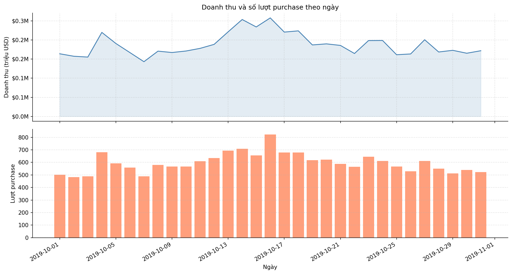
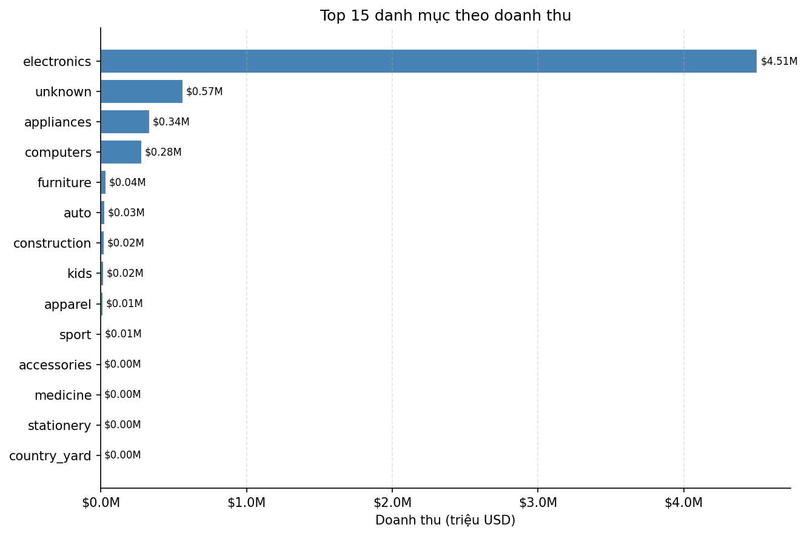
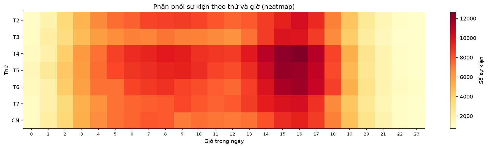
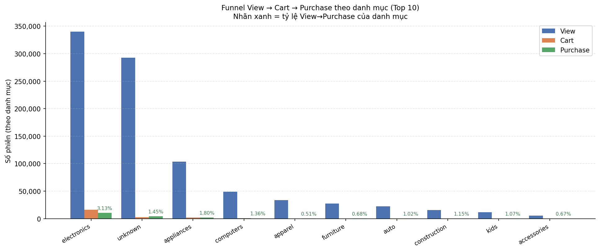
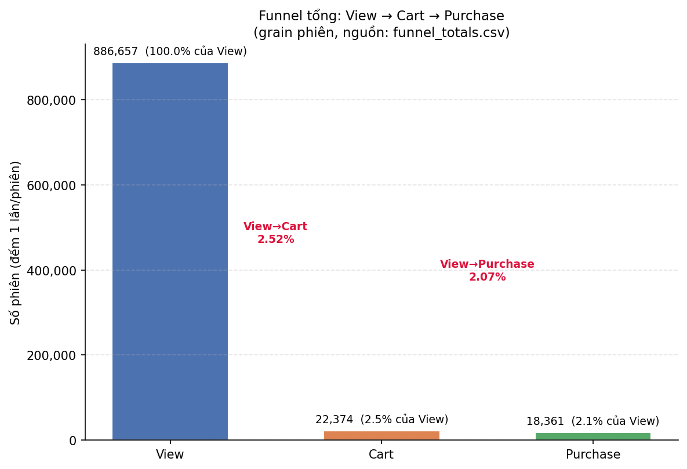
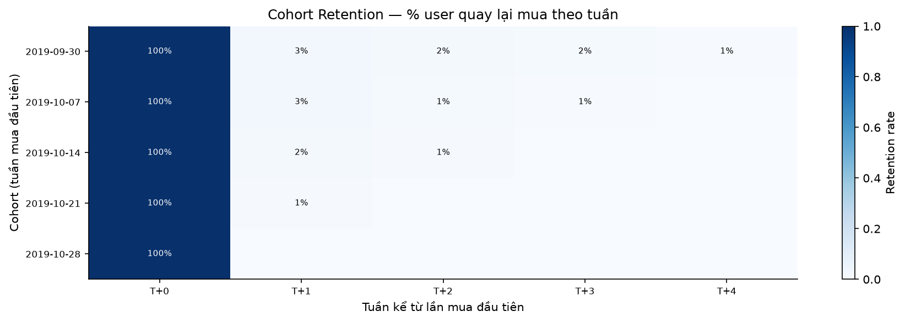
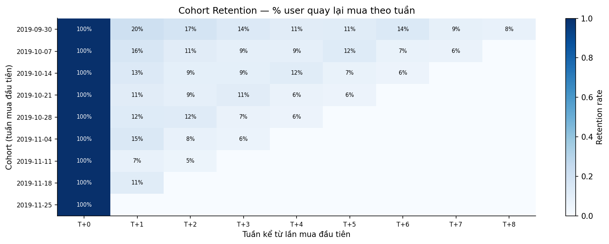

# Báo cáo — Phần của M4 (Analytics: KPI, Funnel, Cohort — Chương 7 Demo kết quả)

> **Tác giả**: M4 (Analytics — KPI / Funnel / Cohort)
> **Module**: `src/analytics/kpi.py`, `src/analytics/run_analytics.py`, `src/analytics/plots.py`, `tests/test_kpi.py`, `tests/test_plot_funnel.py`
> **Số liệu**: trích trực tiếp từ `results/` (tier S) và `results/tier_m/` (tier M) — không điền tay.
> **Môi trường đo**: Spark 3.5.4 trên Docker Compose (1 master + 2 worker), dữ liệu REES46 tháng 10/2019.

---

## 7.1. Phạm vi và cách đọc các con số

Chương này trình bày các chỉ số kinh doanh rút ra từ tầng Gold, kèm biểu đồ và diễn giải nghiệp vụ. Ba nhóm phân tích:

| Nhóm | Hàm sinh số | File kết quả | Biểu đồ |
|------|-------------|--------------|---------|
| KPI tổng hợp | `compute_kpi_summary` | `results/kpi_summary.csv` | — |
| Chuỗi thời gian | `revenue_by_day`, `revenue_by_category`, `hourly_pattern` | `results/revenue_by_*/`, `results/hourly_pattern/` | `revenue_timeseries.png`, `revenue_by_category.png`, `hourly_heatmap.png` |
| Funnel | `funnel_by_category`, `compute_funnel_totals` | `results/funnel_by_category/`, `results/funnel_totals.csv` | `funnel_by_category.png`, `funnel_waterfall.png` |
| DAU | `compute_dau` | `results/dau/` | — |
| Cohort | `compute_cohort_retention` | `results/cohort_retention/` | `cohort_retention.png` |

**Hai giả định bắt buộc phải nêu khi trích dẫn số**:

1. **Revenue là proxy.** Dataset REES46 không có `order_id` và **không có cột `quantity`**. Toàn bộ doanh thu trong báo cáo tính bằng `SUM(price) WHERE event_type = 'purchase' AND price > 0`, tức ngầm giả định mỗi dòng purchase có số lượng = 1. Đây là **proxy doanh thu**, không phải doanh thu kế toán. Kéo theo **AOV cũng là proxy** (Revenue / số phiên đã mua).
2. **Giờ trong ngày là UTC.** `event_hour` sinh từ `event_ts` (UTC) trong `silver_to_gold.py`. Các nhận định "buổi sáng/buổi chiều" dưới đây phải hiểu là **giờ UTC**, chưa quy đổi về múi giờ của sàn hay của người đọc.

---

## 7.2. KPI tổng hợp

### 7.2.1. Bảng KPI

| KPI | Tier S (mẫu 2.5%) | Tier M (toàn bộ T10/2019) | Tier L (T10+T11/2019) |
|-----|-------------------|---------------------------|------------------------|
| Total Revenue (proxy) | 5.813.952,29 | 229.933.212,63 | **505.126.293,44** |
| Total Sessions | 921.388 | 9.244.772 | **23.017.602** |
| Sessions có view | 886.657 | 9.243.001 | 23.006.536 |
| Converted sessions (có purchase) | 18.361 | 629.560 | **1.402.758** |
| **Conversion Rate** | **0,0207** (2,07%) | **0,0681** (6,81%) | **0,0610** (6,10%) |
| Sessions có cart | 22.374 | 573.099 | 2.316.446 |
| **Cart Abandonment** | **0,9812** (98,12%) | **0,4907** (49,07%) | **0,5941** (59,41%) |
| **AOV proxy** | **316,65** | **365,23** | **360,10** |

Nguồn: `results/kpi_summary.csv`, `results/tier_m/kpi_summary.csv`, `results/tier_l/kpi_summary.csv`.

**Tier M và tier L nhất quán với nhau** dù khác khoảng thời gian — conversion 6,81% vs 6,10%,
AOV 365,23 vs 360,10 (lệch < 2%). Đây là bằng chứng pipeline ổn định khi mở rộng dữ liệu.
Cart abandonment khác nhiều hơn (49,07% → 59,41%) chủ yếu do 3 ngày 15–17/11 bất thường
(xem §7.6.2).

### 7.2.2. Kiểm tra tính hợp lý

Ba phép kiểm tra theo hướng dẫn phân công, kết quả **đều đạt** ở cả tier M và tier L:

| Kiểm tra | Ngưỡng hợp lý e-commerce | Tier M | Tier L | Kết luận |
|----------|--------------------------|--------|--------|----------|
| Conversion rate | 1–5% | 6,81% | 6,10% | Hơi cao nhưng cùng bậc; hợp lý vì mẫu số là "phiên có view" |
| Total revenue | > 0 | 229,9 triệu USD | 505,1 triệu USD | Đạt |
| AOV proxy | 50–500 USD | 365,23 USD | 360,10 USD | Đạt |

**Giá trị AOV 365 USD** khớp với thống kê giá ở tầng Silver (`results/price_stats.csv`, tier S: trung bình 290,74 USD, cao nhất 2.574,07 USD). AOV > giá trung bình là điều kiện cần đúng, vì AOV chỉ tính trên các phiên đã mua (thiên về hàng giá trị cao).

### 7.2.3. Vì sao tỷ lệ conversion chốt mẫu số là "phiên có view"?

Công thức chuẩn e-commerce là *"trong số người đã xem hàng, bao nhiêu % mua?"*. Dùng `sessions_with_view` làm mẫu số thay vì `total_sessions` vì tồn tại phiên chỉ có purchase mà không có view (mua trực tiếp qua link/deep-link) — hợp lệ trong dữ liệu. Ở tier M, `total_sessions` = 9.244.772 nhưng `sessions_with_view` = 9.243.001, chênh 1.771 phiên chỉ-mua. Nếu chia cho `total_sessions` thì 1.771 phiên đó bị tính vào mẫu số dù không hề "xem hàng", làm sai định nghĩa.

### 7.2.4. ⚠️ Cảnh báo quan trọng: KPI tier S **không** so sánh được với tier M

Hai cột trong bảng 7.2.1 **không** phải hai phép đo của cùng một đại lượng. Chênh lệch không nằm ở dung lượng dữ liệu mà ở **phương pháp lấy mẫu**:

- Tier S dùng `df.sample(fraction=0.025, seed=42)` (`src/prepare_input/main.py`, hàm `sample_tier_s`) — lấy mẫu **theo từng dòng**, độc lập.
- Lấy mẫu theo dòng **chia cắt phiên**: một phiên 10 sự kiện được giữ lại trung bình 0,25 sự kiện, nên phần lớn dòng sống sót trở thành phiên "cụt" chỉ còn 1 sự kiện.

Bằng chứng định lượng:

| Chỉ số | Tier S | Tier M |
|--------|--------|--------|
| Số dòng bronze | 1.060.438 | 42.448.764 |
| Số phiên `fact_sessions` | 921.388 | 9.244.772 |
| **Số sự kiện / phiên** | **1,15** | **4,59** |
| Số phiên nếu bảo toàn cấu trúc phiên (2,5% × tier M) | ~231.000 | — |
| Số phiên thực tế quan sát ở tier S | 921.388 (**≈ 4,0×**) | — |

Hệ quả trực tiếp lên KPI:

- **Cart abandonment 98,12% (S) vs 49,07% (M)**: khi phiên bị chia cắt, dòng `cart` và dòng `purchase` của cùng một phiên gốc thường không cùng sống sót → phiên còn `cart_count > 0` mà `purchase_count = 0`, bị tính là bỏ giỏ. Ở tier S chỉ 421/22.374 phiên có cart là có purchase.
- **Conversion rate 2,07% (S) vs 6,81% (M)**: cùng cơ chế, mẫu số (phiên có view) bị phình lên so với tử số (phiên có purchase).

**Kết luận sử dụng**: mọi diễn giải nghiệp vụ trong báo cáo lấy **tier M** làm chuẩn. Tier S chỉ dùng để kiểm thử pipeline và đối chiếu tính đúng đắn (E6), **không** dùng để kết luận về hành vi khách hàng. Bảng "KPI chính (tier S)" trên README cần đọc kèm cảnh báo này.

> **Phân biệt với E6**: E6 kết luận đúng (3/3 KPI lệch < 0,1% ở cả hai tier) vì E6 so **Spark với DuckDB trên cùng một bản Silver**. Cả hai engine nhìn cùng dữ liệu đã bị chia cắt như nhau, nên E6 xác nhận *engine tính đúng*, **không** xác nhận *mẫu đại diện cho tổng thể*. Hai câu hỏi khác nhau, không được viện dẫn lẫn nhau.

---

## 7.3. Doanh thu theo thời gian

### 7.3.1. Doanh thu theo ngày

| Chỉ số (tier M) | Giá trị |
|---|---|
| Doanh thu trung bình/ngày | 7.417.200 USD |
| Ngày thấp nhất | 02/10/2019 — 6.213.629 USD |
| Ngày cao nhất | 16/10/2019 — 9.747.165 USD |
| Biên độ max/mean | **1,31×** |

Nhận định: doanh thu tháng 10/2019 khá ổn định, không có cú sốc. Ngày 16/10 cao nhất (+31% so với trung bình) trùng với cụm tăng của cả tuần 14–18/10. Xu hướng chung: **tăng dần nửa đầu tháng, đạt đỉnh giữa tháng, giảm nhẹ về cuối tháng** — phù hợp với việc người dùng nhận lương/chuyển sang chuẩn bị mùa mua sắm cuối năm, nhưng dữ liệu 1 tháng là quá ngắn để khẳng định mùa vụ.

**Lưu ý kỹ thuật đã sửa**: biểu đồ cũ vẽ panel thứ hai là "Số phiên" bằng cách cộng cột `sessions` của `agg_daily`. `agg_daily` có grain `(event_date × category_l1)`, nên một phiên chạm nhiều danh mục bị cộng nhiều lần: tier S ra 941.133 "phiên" trong khi `fact_sessions` chỉ có 921.388 phiên duy nhất (**phồng 2,1%**). Panel này nay vẽ **số lượt purchase** — đại lượng cộng dồn hợp lệ ở grain đó — và trục tung ghi rõ đơn vị.

### 7.3.2. Doanh thu theo danh mục

Top 3 ngành hàng theo doanh thu (tier M): `electronics` 176,4 triệu USD (76,7%), `unknown` 22,9 triệu (10,0%), `appliances` 13,6 triệu (5,9%). Điện tử chiếm hơn 3/4 doanh thu — đây là sàn có tính tập trung ngành hàng rất cao, không phải sàn đa ngành cân bằng.

Nhóm `unknown` đứng thứ hai là **hệ quả trực tiếp của chất lượng dữ liệu**: 31,9% dòng bronze thiếu `category_code` (R6 trong `bronze_to_silver.py` gán `category_l1 = "unknown"`). Đây là nợ dữ liệu phải nêu, **không** phải một ngành hàng thật.

### 7.3.3. Mẫu giờ × thứ — và trả lời "giờ nào, thứ nào doanh thu cao nhất?"

**Trả lời trực tiếp hai câu hỏi của mục 7:** giờ doanh thu cao nhất là **09h UTC**, thứ doanh
thu cao nhất là **Thứ 5** (tier M: 37,06 triệu USD, 16,1% tổng doanh thu; tái lập ở tier S:
946.318 USD, 16,3%).

#### a) Theo giờ

| Giờ (UTC) | Sự kiện | Doanh thu | Doanh thu / sự kiện |
|---|---|---|---|
| 09 | 2.349.336 | **17.551.670** ← doanh thu cao nhất | **7,47** ← cao nhất |
| 10 | 2.295.245 | 16.361.934 | 7,13 |
| 16 | **3.053.226** ← đông nhất | 10.636.257 | 3,48 |
| 17 | 2.732.443 | 9.395.006 | 3,44 ← thấp nhất |

Lượng truy cập đạt đỉnh 16h nhưng "mật độ giá trị" mỗi sự kiện chỉ bằng **46%** so với 9h
(3,48 vs 7,47). Giờ thấp điểm tương tác là 23h (221.975 sự kiện).

#### b) Theo thứ

| Thứ (tier M) | Doanh thu | % tổng | Sự kiện | Doanh thu / sự kiện |
|---|---|---|---|---|
| **Thứ 5** | **37.064.086** | **16,1%** | 6.648.353 | 5,58 |
| Thứ 4 | 36.093.986 | 15,7% | **6.797.348** ← đông nhất | 5,31 |
| Thứ 6 | 35.850.982 | 15,6% | 6.376.063 | 5,62 |
| Thứ 7 | 31.729.267 | 13,8% | 5.824.835 | 5,45 |
| Thứ 3 | 30.158.469 | 13,1% | 5.317.662 | 5,67 |
| Thứ 2 | 29.907.554 | 13,0% | 5.851.611 | 5,11 ← thấp nhất |
| CN | 29.128.868 | 12,7% | 5.602.672 | 5,20 |

Cùng một nghịch lý như theo giờ: **Thứ 4 đông người nhất nhưng Thứ 5 mới là ngày doanh thu
cao nhất**. Mật độ giá trị của Thứ 4 (5,31) thấp hơn Thứ 5 (5,58) và Thứ 6 (5,62).

**Diễn giải nghiệp vụ**: buổi chiều và giữa tuần là cao điểm **duyệt xem** (nhiều view, chưa
quyết định), buổi sáng và cuối tuần làm việc là cao điểm **chốt đơn**. Xu hướng này tái lập
được ở **cả tier S và tier M**, nên không phải nhiễu mẫu.

**Lưu ý về giờ**: toàn bộ tính bằng **UTC**. Nếu sàn phục vụ khách ở UTC+7 thì 09h UTC = 16h
giờ Việt Nam — đúng lúc cao điểm mua sắm buổi chiều. Chưa có thông tin múi giờ người dùng trong
dataset nên **không** được khẳng định "buổi sáng là cao điểm chốt đơn" như một kết luận về
hành vi người dùng.

---

## 7.4. Funnel chuyển đổi

### 7.4.1. Funnel toàn cục — grain phiên

| Bước | Tier M | % của View | Tier S | % của View |
|---|---|---|---|---|
| View | 9.243.001 | 100% | 886.657 | 100% |
| Cart | 573.099 | 6,20% | 22.374 | 2,52% |
| Purchase | 629.560 | 6,81% | 18.361 | 2,07% |

### 7.4.2. Ba bước **không** lồng nhau — sai lầm cần tránh

Ở tier M, **Purchase (629.560) lớn hơn Cart (573.099)**. Đây không phải lỗi: một phiên mua trực tiếp mà không bỏ vào giỏ là hợp lệ, và ở grain `(phiên, danh mục)` hiện tượng này rất rõ — ví dụ danh mục `unknown` có `cart_to_purchase_rate = 2,19`, `apparel` = 344,4. Vì vậy:

- **Không** được vẽ funnel như 3 bậc thang lồng nhau và tính "drop-off từng bước".
- Phiên bản biểu đồ cũ mô tả cart→purchase như một bước rơi, dẫn tới nhãn vô nghĩa. Bản hiện tại chỉ ghi **tỷ lệ so với View** (`View→Cart`, `View→Purchase`) — luôn có nghĩa vì mẫu số là bước lớn nhất.

### 7.4.3. ⚠️ Đếm trùng khi cộng dồn funnel theo danh mục

`agg_funnel` có grain `(user_session, category_l1)` (`src/processing/silver_to_gold.py`, `build_agg_funnel`). Một phiên chạm N danh mục nằm ở N dòng, nên **cộng dồn cột theo danh mục sẽ đếm một phiên nhiều lần**:

| Nguồn | View | Cart | Purchase |
|---|---|---|---|
| Tổng cộng dồn `funnel_by_category` | 905.652 | 22.378 | 18.378 |
| `kpi_summary.csv` (grain phiên) | **886.657** | **22.374** | **18.361** |
| Sai lệch | +2,14% | +0,02% | +0,09% |

Đây là lỗi có thật trong phiên bản biểu đồ đầu tiên. Cách sửa đã thực hiện:

1. Thêm `compute_funnel_totals(fact_sessions)` trong `kpi.py` — tính trực tiếp trên `fact_sessions` (grain 1 dòng = 1 phiên), ghi ra `results/funnel_totals.csv`.
2. `plots.py` đọc theo thứ tự ưu tiên `funnel_totals.csv` → `kpi_summary.csv` → tổng `funnel_by_category` (phương án cuối, có in cảnh báo "đếm trùng" ra console).
3. Khoá hành vi bằng `tests/test_plot_funnel.py` (6 test, thuần pandas).

### 7.4.4. Funnel drop-off lớn nhất ở đâu?

Vì 3 bước không lồng nhau, câu hỏi "rơi nhiều nhất ở bước nào" được trả lời bằng **tỷ lệ so với View**:

- Chỉ **6,20%** phiên có view dẫn tới cart → **View → Cart là nút thắt lớn nhất**, mất ~93,8% ngay ở bước đầu.
- Trong số phiên đã tới cart, phần lớn chốt đơn: `Purchase/Cart = 629.560/573.099 = 1,10`.

Diễn giải: vấn đề của sàn **không phải** ở bước thanh toán mà ở bước **chuyển từ xem sang thêm giỏ**. Cart abandonment 49,07% (tier M) là con số trung bình ngành; điểm nghẽn thật nằm trước đó.

### 7.4.5. Danh mục nào conversion cao nhất?

Điều kiện lọc: ≥ 10.000 phiên có view (loại danh mục quá nhỏ gây nhiễu).

| Hạng | Danh mục | View→Purchase (tier M) | View→Purchase (tier S) |
|---|---|---|---|
| Cao nhất | `electronics` | 8,46% | 3,13% |
| | `appliances` | 6,37% | 1,80% |
| | `computers` | 4,78% | 1,35% |
| Thấp nhất | `apparel` | 1,90% | 0,51% |
| | `sport` | 2,02% | 0,66% |
| | `accessories` | 2,17% | 0,67% |

**Thứ hạng nhất quán giữa hai tier** (điện tử > gia dụng > máy tính … may mặc thấp nhất) — đây là kết luận đáng tin, khác với các con số tuyệt đối bị lệch do lấy mẫu.

---

## 7.5. DAU và trade-off `countDistinct` vs `approx_count_distinct`

`compute_dau` tính song song hai cách đếm để so sánh chi phí/độ chính xác:

| | Tier S | Tier M |
|---|---|---|
| DAU trung bình | 27.607 | 208.830 |
| DAU thấp nhất | 22.546 | 170.668 |
| DAU cao nhất | 32.229 | 231.849 |
| Sai số `approx` trung bình | 3,27% | 3,48% |
| Sai số `approx` lớn nhất | 8,75% | 7,48% |

Nhận định: `approx_count_distinct` (HyperLogLog, độ chính xác mặc định `rsd = 0,05`) lệch trung bình ~3,5%, cá biệt tới 8,7% theo ngày. Với báo cáo KPI cần số khớp sổ, **phải dùng `countDistinct`**; `approx` chỉ nên dùng cho dashboard cần độ trễ thấp trên dữ liệu lớn hơn nhiều.

---

## 7.6. Cohort retention

Cohort = nhóm user có **lần mua đầu tiên** trong cùng một tuần. Bảng tier M:

| Cohort (tuần mua đầu) | Cohort size | T+1 | T+2 | T+3 | T+4 |
|---|---|---|---|---|---|
| 30/09/2019 | 78.693 | 20,32% | 17,48% | 13,56% | 7,46% |
| 07/10/2019 | 85.238 | 16,09% | 11,09% | 5,61% | — |
| 14/10/2019 | 80.995 | 13,45% | 5,72% | — | — |
| 21/10/2019 | 69.840 | 7,52% | — | — | — |
| 28/10/2019 | 32.352 | — | — | — | — |

Ba nhận định:

1. **Retention giảm đơn điệu theo tuổi cohort** (20,3% → 17,5% → 13,6% → 7,5% ở cohort cũ nhất) — hình dạng chuẩn của retention curve, xác nhận logic cohort chạy đúng.
2. **Retention tuần 1 giảm dần theo cohort mới hơn**: 20,32% → 16,09% → 13,45% → 7,52%. Cần thận trọng: cohort càng về cuối tháng càng ít cửa sổ quan sát, và cohort 21/10 chỉ có 1 tuần quan sát. Xu hướng giảm có thể là **thiên lệch quan sát (observation bias)**, không hẳn là chất lượng giữ chân đi xuống.
3. **Hạn chế của RIÊNG tier M**: chỉ có dữ liệu **1 tháng** (10/2019) nên tối đa 5 cohort và
   không cohort nào quan sát được quá T+4. Ma trận cohort của tier M vì thế là **tam giác**,
   các ô trống là *chưa quan sát*, **không phải** retention = 0.
   → **Hạn chế này đã được khắc phục** bằng tier L (thêm 11/2019) — xem §7.6.1.

Ngoài ra cohort tính trên `fact_sessions` với `converted = True`, tức chỉ đếm **hành vi mua lại**, không đếm quay lại xem hàng. Đây là định nghĩa "retention mua hàng", hẹp hơn "retention truy cập".

### 7.6.1. Cohort tier L — đã chạy được đủ 9 tuần (hoàn thành W3)

Sau khi có `2019-Nov.csv`, pipeline tier L cho **9 cohort và quan sát tới T+8**, thay vì
4 cohort / T+4 như tier M:

Ma trận tỉ lệ giữ chân (retention rate), tier L:

| Cohort | Size | T+1 | T+2 | T+3 | T+4 | T+5 | T+6 | T+7 | T+8 |
|---|---|---|---|---|---|---|---|---|---|
| 30/09 | 78.693 | 20,32% | 17,48% | 13,56% | 11,28% | 11,33% | **13,84%** | 8,51% | 7,64% |
| 07/10 | 85.238 | 16,09% | 11,09% | 8,91% | 8,90% | 12,12% | 6,74% | 6,32% | — |
| 14/10 | 80.996 | 13,45% | 9,14% | 9,02% | 11,50% | 6,70% | 5,77% | — | — |
| 21/10 | 69.844 | 10,98% | 8,90% | 11,25% | 6,28% | 5,55% | — | — | — |
| 28/10 | 58.849 | 12,24% | 11,92% | 6,64% | 5,74% | — | — | — | — |
| 04/11 | 68.256 | 14,67% | 7,57% | 6,09% | — | — | — | — | — |
| 11/11 | 146.156 | 7,18% | 5,26% | — | — | — | — | — | — |
| 18/11 | 57.777 | 11,35% | — | — | — | — | — | — | — |
| 25/11 | 51.661 | — | — | — | — | — | — | — | — |

**Ba nhận định từ tier L:**

1. **Baseline retention**: T+1 dao động 7,18%–20,32% (trung bình **13,28%**), T+2 trung bình
   **10,19%**. Đây là con số đáng tin hơn tier M vì có đủ cửa sổ quan sát cho cả 9 cohort.
2. **Retention KHÔNG đơn điệu** — cohort 30/09 tăng từ 11,28% (T+4) lên 13,84% (T+6).
   Nguyên nhân trực tiếp là **cụm bất thường 15–17/11** (§7.6.2): purchase bị dồn vào 16–17/11,
   nên tuần 11–17/11 đạt **345.769 purchase** — gấp đôi tuần thường (~170.000). Retention T+6 của
   cohort cũ rơi đúng vào tuần đó nên bị đẩy lên.
   Vì vậy **không được** mô tả retention curve của dataset này là "giảm đơn điệu" — nhưng cũng
   **không được** coi mức tăng đó là cải thiện giữ chân thật.
3. **Cohort 11/11 có size đột biến 146.156** (gấp ~1,9× các cohort khác) rồi T+1 chỉ 7,18%.
   Nguyên nhân đã kiểm chứng bằng số liệu, **không phải phỏng đoán**: cohort tuần 11/11 chứa
   luôn 16–17/11 — hai ngày purchase vọt bất thường — nên hút rất nhiều "khách mua lần đầu"
   vào cùng một cohort. Tỉ lệ giữ chân vì thế bị loãng xuống.
   Đây là **hiệu ứng thành phần (composition effect)** gây ra bởi lỗi dữ liệu, không phải chất
   lượng giữ chân đi xuống.

**Đối chiếu tier M vs tier L ở các ô trùng** — khác biệt đều giải thích được bằng việc tier L
có thêm tháng 11, **không phải lỗi pipeline**:

| Ô | Tier M | Tier L | Giải thích |
|---|---|---|---|
| Cohort 30/09, T+0..T+3 | 78.693 / giống nhau | 78.693 / giống nhau | Trùng khớp tuyệt đối ✅ |
| Cohort 30/09, T+4 | 7,46% | 11,28% | Tuần 28/10–03/11: tier M chỉ có 28–31/10, tier L có thêm 01–03/11 |
| Cohort 28/10, size | 32.352 | 58.849 | Tier L tính cả user mua lần đầu 01–03/11 vào cohort này |

### 7.6.2. ⚠️ Phát hiện dữ liệu: tháng 11/2019 thiếu purchase ngày 15/11

Trong lúc phân tích tier L, phát hiện một **bất thường nghiêm trọng ở dữ liệu nguồn**:

| Ngày | Purchase | View | Doanh thu |
|---|---|---|---|
| 13/11 | 22.548 | 1.924.916 | 6,81 triệu |
| 14/11 | 22.124 | 2.877.071 | 6,95 triệu |
| **15/11** | **0** | 5.737.078 | **0** |
| 16/11 | 68.247 | 6.027.799 | 23,44 triệu |
| **17/11** | **185.195** | 5.783.122 | **57,77 triệu** |
| 18/11 | 28.537 | 1.909.738 | 8,25 triệu |

**Đã kiểm chứng: lỗi ở dữ liệu nguồn, KHÔNG phải pipeline.**
Truy vấn trực tiếp tầng **bronze** (Parquet chưa qua bất kỳ luật lọc nào) cũng cho **0 purchase
ngày 15/11**. Tầng silver chỉ loại 130.739 dòng trùng lặp R7 trên toàn bộ 109,95 triệu dòng,
không thể xoá riêng purchase của một ngày.

**Đánh giá tác động**:

| Chỉ số | Giá trị |
|---|---|
| Purchase 3 ngày 15–17/11 | **253.442** |
| Purchase 3 ngày bình thường (kỳ vọng) | ~72.738 |
| Tỉ lệ so với kỳ vọng | **3,5×** |
| Chiếm % tổng purchase tier L | **15,3%** |
| Chiếm % tổng doanh thu tier L | **16,1%** |

**Hệ quả lên báo cáo**:

- Biểu đồ doanh thu theo ngày có một đỉnh nhọn 17/11 (57,77 triệu, gấp **7×** trung bình ngày
  8,28 triệu) — đây là **artifact của dữ liệu**, không phải hiệu ứng kinh doanh thật.
- Mọi KPI cấp tier L bị **lệch lên** đáng kể: nếu 3 ngày đó ở mức bình thường, doanh thu tier L
  sẽ khoảng **480 triệu** thay vì 505 triệu (~5% thấp hơn).
- Cohort retention các tuần quanh 15–17/11 bị méo theo (giải thích mục 2 ở §7.6.1).

**Khuyến nghị ghi vào báo cáo Chương 3 (Dữ liệu) và mục Hạn chế**: không dùng số liệu tier L để
kết luận về mùa vụ hay tăng trưởng của tháng 11 mà chưa loại trừ 3 ngày 15–17/11. Đây là hạn chế
của **nguồn dữ liệu REES46**, không phải của nhóm — nhưng phải chủ động nêu ra.

> **Việc cần nhóm kiểm tra thêm**: đối chiếu với trang Kaggle xem dataset có ghi chú về lỗi này
> không. Nếu có, trích dẫn vào báo cáo; nếu không, ghi nhận đây là phát hiện của nhóm.

---

## 7.7. Kiểm chứng tính đúng đắn

| Hạng mục | Kết quả | Nguồn |
|---|---|---|
| E6 — oracle DuckDB vs Spark, tier S | 3/3 KPI < 0,1% | `results/e6_correctness_report.csv` |
| E6 — oracle DuckDB vs Spark, tier M | 3/3 KPI < 0,1% | `results/tier_m/e6_correctness_report.csv` |
| Unit test KPI (Spark) | `tests/test_kpi.py` — 6 test | chạy bằng `make test` trong container |
| Unit test tổng hợp funnel (pandas) | `tests/test_plot_funnel.py` — 6 test PASS | chạy được cả ngoài container |
| Lint | `ruff check src/ tests/` — sạch | — |

Chi tiết E6:

| Tier | Metric | Oracle | Spark | Lệch |
|---|---|---|---|---|
| S | total_revenue | 5.813.952,29 | 5.813.952,29 | 0,0000% |
| S | total_sessions | 921.388 | 921.388 | 0,0000% |
| S | conversion_rate | 0,02070812 | 0,0207 | 0,0392% |
| M | total_revenue | 229.933.212,63 | 229.933.212,63 | 0,0000% |
| M | total_sessions | 9.244.772 | 9.244.772 | 0,0000% |
| M | conversion_rate | 0,06811208 | 0,0681 | 0,0177% |

Lệch conversion_rate ở mức 0,02–0,04% là do `kpi_summary.csv` làm tròn 4 chữ số thập phân, không phải sai số tính toán.

---

## 7.8. Tổng hợp: phát hiện và việc đã sửa trong đợt này

| # | Vấn đề | Ảnh hưởng | Trạng thái |
|---|---|---|---|
| 1 | Funnel tổng cộng dồn `funnel_by_category` (grain phiên × danh mục) | View phồng 2,14% (905.652 vs 886.657) | ✅ Sửa: thêm `compute_funnel_totals`, ghi `funnel_totals.csv`, có test |
| 2 | Vẽ funnel như 3 bậc lồng nhau → nhãn drop-off vô nghĩa khi Purchase > Cart | Hiểu sai điểm nghẽn | ✅ Sửa: chỉ hiển thị tỷ lệ so với View |
| 3 | Panel "Số phiên" cộng `agg_daily.sessions` theo ngày | Phồng 2,1% (941.133 vs 921.388) | ✅ Sửa: vẽ số lượt purchase, ghi rõ đơn vị |
| 4 | Heatmap map nhãn thứ theo **vị trí index** | Gán sai nhãn nếu thiếu một thứ | ✅ Sửa: map theo giá trị `day_of_week` |
| 5 | `plots.py` crash `UnicodeEncodeError` trên console Windows cp1252 | Không sinh được biểu đồ ngoài container | ✅ Sửa: ép UTF-8 cho stdout/stderr, backend `Agg` |
| 6 | KPI tier S bị đọc như số liệu nghiệp vụ | Kết luận sai (abandonment 98% vs 49%) | ✅ Ghi cảnh báo §7.2.4 + cập nhật README |

**Hạn chế còn lại (không sửa trong phạm vi M4)**:

- Không chạy lại được pipeline trên máy hiện tại (Docker daemon không khởi động, không có `data/raw`) → các biểu đồ được sinh lại **từ `results/` đã đo sẵn**, không phải từ lần chạy Spark mới. Khi có môi trường, chạy `make analytics TIER=M PIPELINE_CONFIG=/app/configs/pipeline-m5-tier-m.yaml` sẽ sinh `funnel_totals.csv` trực tiếp từ `fact_sessions`.
- Chưa có phân tích cohort theo **tuần lịch đầy đủ** do thiếu tháng 11.

---

## 7.9. Câu trả lời bảo vệ cho phần M4

**"Conversion rate của nhóm là bao nhiêu, tính thế nào?"**
> Tier M: 6,81% = 629.560 phiên có purchase / 9.243.001 phiên có view. Không chia cho tổng số phiên vì mẫu số phải là "người đã xem hàng". Tier S ra 2,07% nhưng **không dùng con số này để kết luận** — lấy mẫu theo dòng ở tier S chia cắt phiên, làm mẫu số phình lên (chi tiết §7.2.4).

**"Cart abandonment 98% ở tier S có phải lỗi không?"**
> Không phải lỗi code, là hệ quả của lấy mẫu theo dòng: dòng cart và dòng purchase của cùng một phiên gốc thường không cùng sống sót, nên phiên bị coi là bỏ giỏ. Số đúng để báo cáo là tier M: 49,07%. Đã ghi cảnh báo trong báo cáo và README.

**"Funnel drop-off lớn nhất ở bước nào?"**
> View → Cart. Chỉ 6,20% phiên có view dẫn tới cart ở tier M; Purchase/Cart = 1,10 (nên không có "rơi" ở bước sau). Điểm nghẽn nằm ở việc thêm giỏ, không phải thanh toán.

**"Vì sao Purchase lại lớn hơn Cart trong funnel?"**
> Vì ba bước không lồng nhau — có phiên mua trực tiếp không qua giỏ. Ở grain (phiên, danh mục) điều này thể hiện rõ: `cart_to_purchase_rate` của `unknown` là 2,19, của `apparel` là 344,4. Vì vậy biểu đồ chỉ hiển thị tỷ lệ so với View.

**"Số liệu có đáng tin không?"**
> Về mặt engine: E6 đối chiếu DuckDB oracle với Spark, 3/3 KPI lệch < 0,1% ở cả tier S và M. Về mặt mẫu: tier M dùng toàn bộ tháng 10 nên đại diện; tier S bị thiên lệch do lấy mẫu theo dòng. Hai khẳng định này độc lập, không thay thế nhau.

**"Category nào conversion cao nhất, giờ nào và thứ nào doanh thu cao nhất, funnel rơi nhiều nhất ở đâu?"**
> Ba câu trả lời từ số liệu tier M: (1) `electronics` 8,46% — cao nhất trong các danh mục có ≥10.000 phiên view; thấp nhất là `apparel` 1,90%. (2) Doanh thu cao nhất lúc **09h UTC** (17,55 triệu USD, 7,47 USD/sự kiện) và vào **Thứ 5** (37,06 triệu USD, 16,1% tổng); lưu ý 16h đông người nhất nhưng chỉ đạt 3,48 USD/sự kiện. (3) Rơi nhiều nhất ở **View → Cart**: chỉ 6,20% phiên có view dẫn tới cart, còn Purchase/Cart = 1,10 nên bước sau không phải nút thắt.

**"Cohort retention kết luận được gì?"**
> Retention mua lại giảm theo tuổi cohort (20,3% → 7,5% ở cohort 30/09) — đúng hình dạng retention curve. Nhưng chỉ có 1 tháng dữ liệu nên ma trận là tam giác; ô trống là *chưa quan sát*, không phải retention 0. Cần tier L (thêm 11/2019) để kết luận dài hạn.
